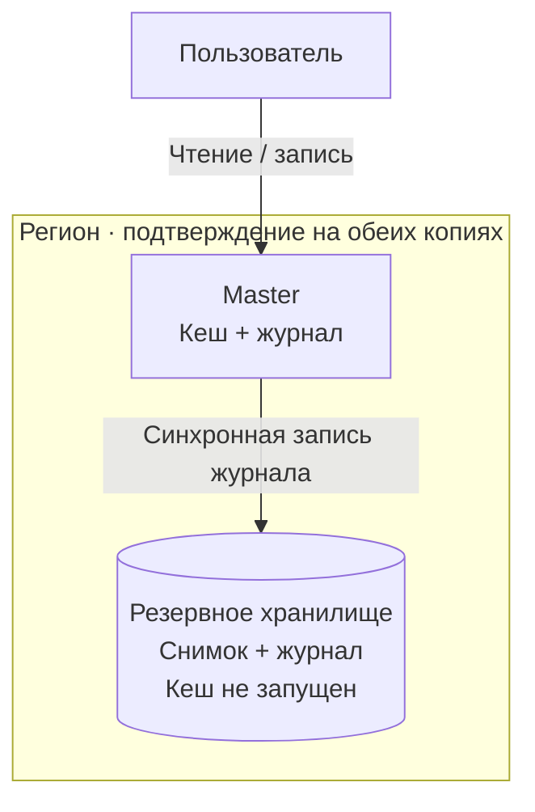
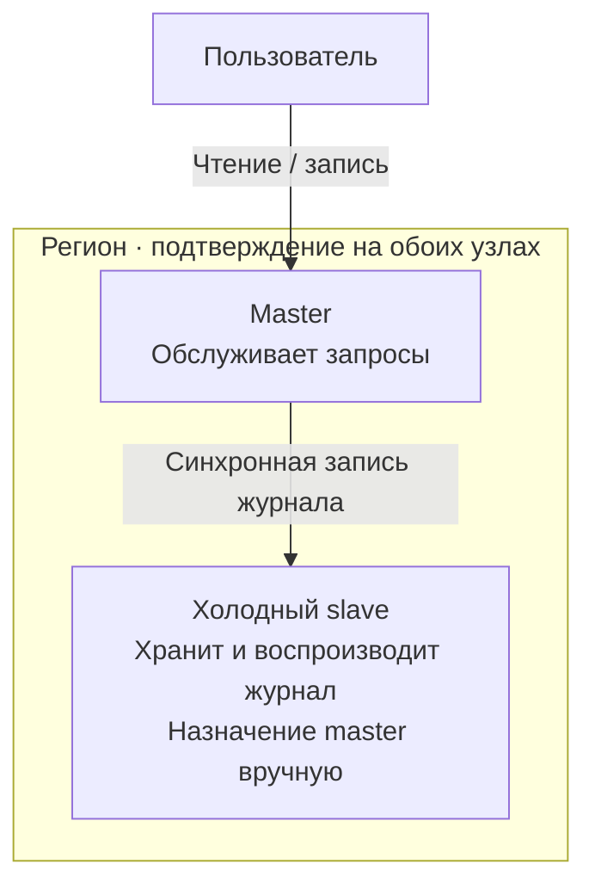
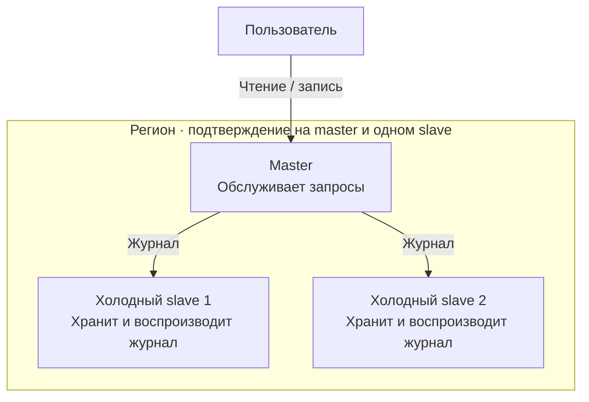
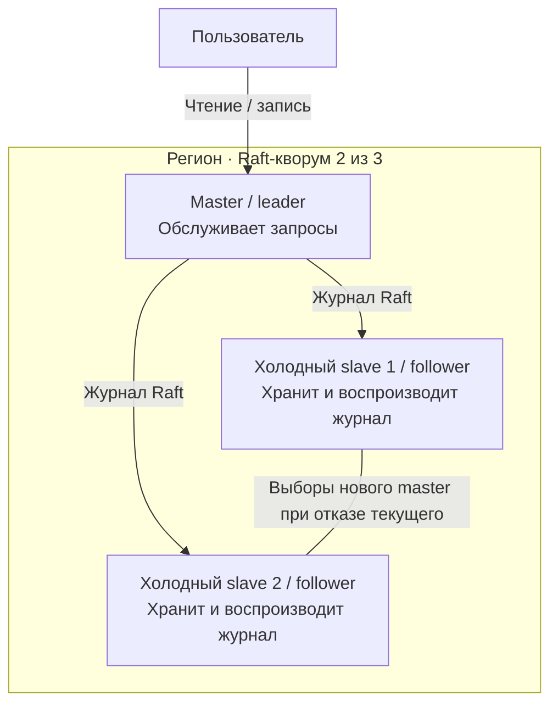

# Отказоустойчивость кеша внутри региона

Область документа — репликация данных, доступность и восстановление одного региона. Межрегиональная репликация, доставка событий из БД и внутренняя логика кеша разрабатываются отдельно. Шардирования в MVP нет.

## Путь развития

**Копия журнала → работающий slave → два slave с ручным переключением → готовый Raft.**

Каждый этап даёт самостоятельный результат. Сначала обеспечиваем восстановление подтверждённых данных, затем сокращаем простой и повышаем доступность. Автоматические выборы собственного изготовления отдельным этапом не реализуем.

| Этап | Состав региона | Подтверждение записи | Переключение master |
| --- | --- | --- | --- |
| 1. Копия журнала | Master и независимое хранилище восстановления | Журнал сохранён на обеих сторонах | Ручной запуск кеша, восстановление и переключение клиентов |
| 2. Работающий slave | Master и один slave, воспроизводящий журнал | Журнал сохранён на обоих узлах | Ручное назначение подготовленного slave |
| 3. Два slave | Master и два работающих slave | Журнал сохранён на master и хотя бы одном slave | Ручное, с проверкой журналов и изоляцией старого master |
| 4. Raft | Три узла одной Raft-группы | Фиксация большинством по правилам Raft | Автоматические выборы и переключение клиентов |

На этапах 2–4 slave холодные в принятом смысле: хранят и применяют данные, но не обслуживают клиентские чтения и записи. Все клиентские запросы принимает текущий master.

## Общий механизм репликации

Master последовательно добавляет изменения в журнал, сохраняет его локально и передаёт резервным копиям. Ответ об успехе отправляет после надёжного сохранения на требуемом числе узлов и применения изменения у себя. Подтверждение реплики означает сохранение непрерывного журнала до указанной позиции. Применение на slave может отставать; перед назначением master необходимый журнал должен быть воспроизведён.

Реплицируются изменения кеша, включая инвалидации и метаданные восстановления: версии и сроки истечения записей. Снимок состояния и последующий журнал позволяют восстановить кеш без обращения к БД. Журнал можно сокращать только при наличии пригодного для восстановления снимка; TTL после восстановления не начинается заново.

Копии размещаются на разных хостах с независимыми дисками. Каждый будущий master должен вмещать весь набор данных и выдерживать полную клиентскую нагрузку региона.

## Этапы и поведение при отказах

### 1. Независимая копия журнала

На резервной стороне работает приёмник журнала или сервис хранения, но экземпляр кеша не запущен. Хранятся полный журнал либо снимок и все последующие записи.

При потере master оператор запускает новый экземпляр, восстанавливает состояние и переключает клиентов. Простой включает реакцию оператора, запуск и воспроизведение журнала. Это первый результат: подтверждённые данные можно восстановить после отказа одного хоста.

Если резервное хранилище недоступно, подтверждение новых записей останавливается.

### 2. Работающий slave

Slave постоянно сохраняет и воспроизводит журнал master. При отказе master оператор дожидается применения необходимого журнала и назначает slave новым master. Время восстановления сокращается: процесс уже запущен, большая часть данных подготовлена.

Сохранность данных та же, что на этапе 1. Потеря slave останавливает подтверждение записей. После потери master остаётся одна копия: чтобы возобновить синхронную запись с прежней гарантией, нужно восстановить резерв. Автоматический переход на запись в одну копию не предусматривается.

### 3. Два slave с ручным переключением

Master передаёт журнал обоим slave, но для ответа клиенту достаточно сохранения у себя и на одном из них. Отказ одного slave больше не останавливает запись. После отказа master остаются две копии, на которых можно продолжить работу после безопасного переключения.

Кворум записи сам по себе не выбирает безопасного нового master. Например, изменение сохранено на master и первом slave, а второй ещё отстаёт. После падения master нельзя назначить второй slave и отбросить более актуальное состояние первого.

При разделении сети текущий master продолжает подтверждать записи, только если доступен хотя бы один slave. Оставшиеся без master реплики самостоятельно его не выбирают. Этот этап повышает доступность при отказе резерва, но сохраняет зависимость от оператора при отказе master.

### 4. Готовый Raft на трёх узлах

Репликацию журнала и передачу лидерства переводим на готовую библиотеку [Raft](https://raft.github.io/raft.pdf). Она связывает выборы большинством с актуальностью журналов, чтобы новый master сохранял подтверждённые изменения.

При отказе master два оставшихся узла выбирают нового. При разделении 2 + 1 обслуживает сторона с большинством; без большинства регион недоступен. Безопасные чтения выполняются через механизм проверки лидерства и применения журнала библиотеки — read barrier / ReadIndex.

Это смена механизма согласования, а не добавление таймера к ручному переключению. Формат команд кеша и интерфейсы снимков можно переиспользовать; совместимость журналов и переход на Raft требуют отдельного решения.

## Безопасное ручное переключение: этапы 1–3

1. Оператор гарантированно останавливает или изолирует старый master от клиентского обслуживания и репликации, исключая его самостоятельный возврат в прежней роли. Одного отсутствия heartbeat недостаточно.
2. Проверяет доступные копии и восстанавливает состояние, содержащее все подтверждённые изменения. Если полноту восстановленного журнала нельзя установить, переключение не выполняется.
3. Назначает новый master и обновляет адрес для клиентского модуля. Запись разрешается после восстановления требуемого числа копий.
4. Вернувшийся старый master синхронизируется с новым и подключается как резерв.

На этих этапах смена роли управляется административной процедурой. На этапе 4 роль определяет Raft, а клиентский модуль обнаруживает нового master через служебный API.

## Восстановление копий и проверка

Сначала пробуем перезапустить узел с его диском. При необходимости замены передаём снимок и оставшийся журнал с исправной копии, ограничивая скорость копирования. Неподготовленная копия не учитывается при подтверждении записей. В Raft новый узел сначала добавляется без права голоса, затем включается в состав штатным механизмом библиотеки.

Общие проверки: сохранность подтверждённых изменений после отказа master, восстановление с диска, прогрев замены и безопасный повтор операции после потерянного ответа. Таймаут не означает, что запись не состоялась.

На этапе 3 дополнительно проверяем отказ одного slave и ручное переключение при разном отставании реплик; на этапе 4 — автоматические выборы, разделение 2 + 1 и потерю большинства. Нужны сигналы ошибок репликации, нехватки копий и смены master, метрики отставания и времени восстановления.

## Граница MVP и зависимости

Предлагаемая цель базового MVP — **этап 2**, с этапом 1 как первым проверяемым результатом. Этапы 3 и 4 — последовательные расширения; достижение всех четырёх за месяц не предполагается.

До реализации согласуем интерфейсы журнала и снимков с компонентом хранения, безопасные повторы операций, способ изоляции старого master и обновления клиентского адреса, допустимое время восстановления и задержку записи. Библиотеку Raft выбираем перед этапом 4.
