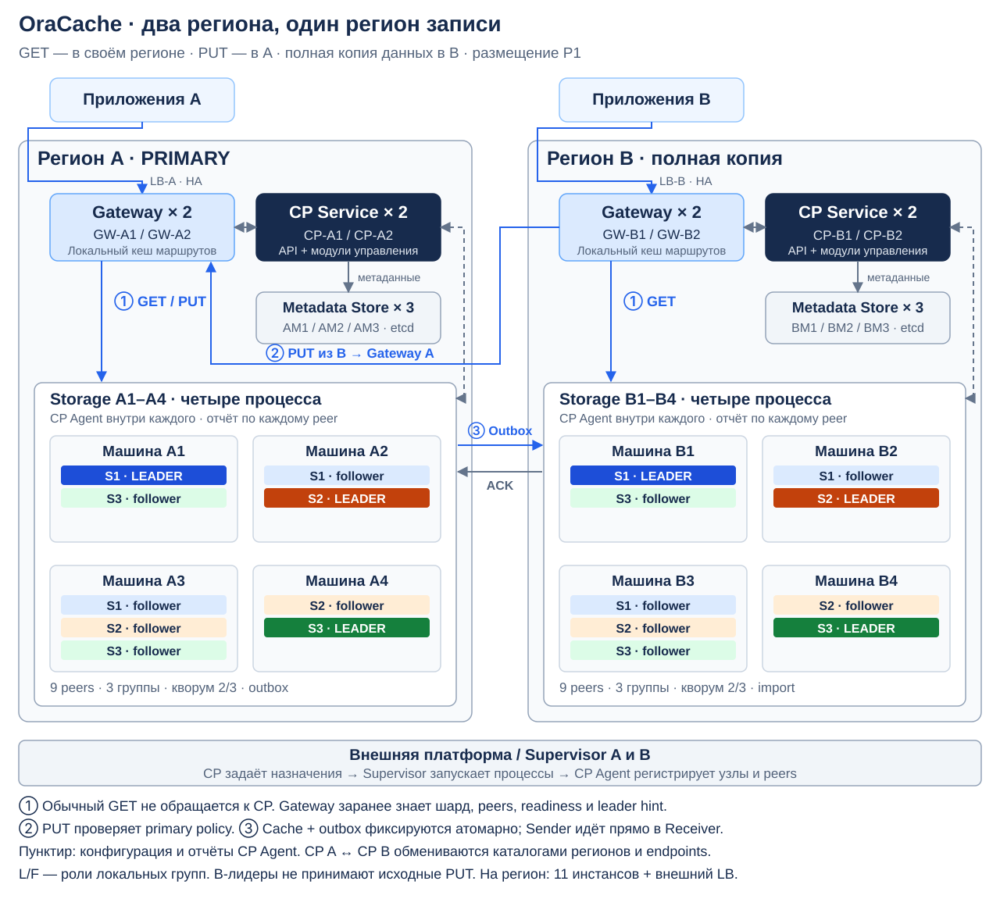

# Как работает распределённость OraCache

Дата: 01.11.2026. Статус: конкретный пример для согласования интерфейсов; размеры инстансов и SLA ещё не рассчитаны. Детали Raft и варианты процессов — в [raft-design.md](raft-design.md).

## 1. Что взято из описания control plane

Источник: [Control plane.pdf](</Users/dashkevichev/Downloads/Control plane.pdf>), 4 страницы. Ссылка ведёт на локальный приложенный файл, не включённый в репозиторий.

Из PDF используем роли и связи: CP Agent собирает состояние peers и получает конфигурацию; Health Aggregator строит observed state; Scheduler выбирает размещение; Controller/Reconciler исполняет план; Command Dispatcher публикует обновления; Gateway кеширует маршруты; External Supervisor запускает процессы. CP сам не выбирает Raft-лидера и не пересылает payload запросов.

В PDF осталось предположение master-master; последнее уточнение пользователя его отменяет. Поэтому меняются следующие положения:

- Вместо независимых writers вводится `primary_region` шарда и поколение полномочий `writer_epoch`.
- Вместо merge нескольких origin-потоков — упорядоченный outbox одного writer.
- CP публикует политику записи и регион назначения, но не выполняет автоматическое переключение primary только по heartbeat.
- Readiness означает достижение контрольной позиции и выполнение политики lag. Постоянный буквальный `lag = 0` при непрерывных записях не требуется.
- `config_version` позволяет атомарно заменить локальную карту и обнаружить устаревший запрос. Сам по себе номер не создаёт одновременного переключения всех узлов или fencing старого writer.

Количество экземпляров CP, тип State Store, конкретные RPC, интервалы heartbeat и схема регионального каталога ниже — наши проектные допущения. В PDF они полностью не определены; внутреннюю реализацию CP этим документом не предписываем.

## 2. Пример продовой топологии

### 2.1. Регионы, сервисы и инстансы

Два региона: **A — единственный регион записи S1/S2/S3; B — полная региональная копия для локальных чтений**. В A и B свои Raft-группы данных и свои control-plane сервисы. B имеет локальных Raft-лидеров, но они принимают только импорт и операции управления, а не исходные PUT/Invalidate.

В рисунке L/F — текущие роли peers. Все стрелки к блоку storage обозначают обращение к нужному peer внутри него; подробные маршруты раскрыты далее.

| Сервис | Регион A | Регион B | Размещение и функция |
| --- | --- | --- | --- |
| Regional ingress/LB | `LB-A`, один HA endpoint | `LB-B`, один HA endpoint | Управляемый региональный балансировщик, распределяет по двум Gateway |
| API Gateway | `GW-A1`, `GW-A2` | `GW-B1`, `GW-B2` | По одной отдельной VM/инстансу; локальный кеш маршрутов, GET/PUT proxy |
| CP Service | `CP-A1`, `CP-A2` | `CP-B1`, `CP-B2` | По одной отдельной VM; API, Dispatcher, Aggregator, Scheduler и Controller как модули одного сервиса |
| Metadata State Store | `AM1`, `AM2`, `AM3` | `BM1`, `BM2`, `BM3` | Для примера — отдельный региональный etcd-кластер из трёх VM; хранит метаданные CP, не значения кеша |
| Storage / OraCache, P1 | `A1`–`A4` | `B1`–`B4` | По процессу на отдельной storage-машине; несколько peers в процессе |
| CP Agent | 4 встроенных экземпляра | 4 встроенных экземпляра | По одному на storage-процесс, отчёты отдельно по каждому peer |
| Replication Sender/Receiver | Встроены в storage | Встроены в storage | Отправка outbox у лидера primary-группы, импорт у лидера группы-копии |
| External Supervisor | Существующая платформа A | Существующая платформа B | Запуск/остановка процессов; внутреннее устройство не входит в OraCache |

Итого для выбранного примера — **11 инстансов OraCache-инфраструктуры на регион: 2 gateway + 2 CP + 3 metadata + 4 storage**, 22 на два региона. Управляемые LB и служебные компоненты платформы запуска считаются внешней инфраструктурой. Это пример распределения ролей, не утверждение, что именно столько машин нужно для заданных RPS.

Оба CP API доступны. Для каждого региона один активный цикл планирования/reconcile получает полномочия через региональный State Store; второй экземпляр может его заменить. Идемпотентные команды дополнительно защищают от повторов. Механизм HA State Store и избрания CP-worker — отдельный от выборов лидеров шардов.

Реплики одной data-группы и члены metadata-кластера разнесены по физическим доменам отказа. Выделенные VM не должны случайно оказаться одним физическим failure domain. CPU/RAM и запас для восстановления определяются после измерения рабочего набора.

Источник БД и доставка инвалидаций внешние: их адаптер передаёт `Invalidate(key, source_event_id)` через Gateway в A. Мы не добавляем Kafka или ещё одну БД только ради outbox.

### 2.2. Какие шарды на каких машинах

| Машина | S1 | S2 | S3 |
| --- | --- | --- | --- |
| A1 | Leader | — | Follower |
| A2 | Follower | Leader | — |
| A3 | Follower | Follower | Follower |
| A4 | — | Follower | Leader |
| B1 | Leader импорта/чтения | — | Follower |
| B2 | Follower | Leader импорта/чтения | — |
| B3 | Follower | Follower | Follower |
| B4 | — | Follower | Leader импорта/чтения |

В каждом регионе 3 группы × 3 peers = 9 реплик. Всего 6 групп и 18 peers. В A2 и B2 находятся разные лидеры одного логического шарда S2, принадлежащие группам A/S2 и B/S2. Только A/S2 принимает исходные изменения.

P1 выбран лишь для конкретной картинки. При P2 те же девять peers региона станут девятью процессами на тех же четырёх машинах; топология групп и сценарии не меняются.

## 3. Какие знания есть у компонентов и откуда они берутся

**CP не подключается к шардовой Raft-группе в специальной роли.** CP Agent читает локальный статус runtime и сообщает его в CP. Gateway тоже не является Raft-peer.

### 3.1. Каталоги

| Информация | Кто является источником | Кто использует |
| --- | --- | --- |
| `key → shard_id`, версия hash/границ | Конфигурация шардирования в CP | Gateway, storage для проверки принадлежности ключа |
| `shard → primary_region, writer_epoch, replica_regions` | Политика записи, в примере авторитетная в CP A | Gateway, storage, Sender |
| `region → gateway endpoint, CP endpoints` | Регистрация регионов в CP; исходные seed endpoints задаёт развёртывание | Gateway и межрегиональное обнаружение |
| Desired peers и физическое размещение | Scheduler + State Store | Controller, supervisor, CP Agent |
| Фактические voters/learners, config index | Committed membership Raft-группы, сообщённое агентами | Controller, каталог маршрутов |
| `group → leader peer, term` | Raft runtime → CP Agent | Gateway, Sender; это подсказка, не гарантия текущего лидерства |
| `peer → host/process/endpoint` | Регистрация процесса/агента | Gateway, Sender, Controller |
| Readiness, apply position, imported sequence | Data plane → CP Agent → Health Aggregator | Gateway, Controller, мониторинг |

Для примера шардирование фиксировано: одна согласованная hash-функция, `hash(key) mod 3` выбирает S1/S2/S3. Это вычисление выполняет Gateway, обращение в CP на каждый ключ не требуется. Во всех сценариях ниже рассматриваем ключ K, принадлежащий S2.

### 3.2. Как обновляется информация

1. При старте Gateway и CP Agent знают адреса **своего** CP из deployment-конфигурации, например `cp-a.internal:8443`. Это bootstrap, не discovery через Raft.
2. Storage-процесс регистрирует `node_id`, регион, физический host ID и endpoints; после запуска peers сообщает их отдельные статусы.
3. CP Agent отправляет периодические heartbeat/status и внеочередной отчёт при смене лидера, membership или readiness. Пример настройки: heartbeat 2 с, статус suspect после 10 с; числа требуют измерения и не являются гарантией обнаружения отказа.
4. Health Aggregator обновляет observed state. Controller отличает желаемое размещение от уже committed-состава. Нельзя объявить новый peer действующим только потому, что он появился в desired plan.
5. Gateway получает полный snapshot маршрутов, затем изменения от Dispatcher по stream; периодический pull восстанавливает пропущенные обновления. Та же схема используется CP Agent/Sender.
6. При `NotLeader`, недоступном endpoint или несовпадении версии Gateway использует leader hint и/или обновляет маршрут. Повторы ограничены deadline; ошибка транспорта не выдаётся за cache miss.

Поздний heartbeat не должен откатывать наблюдаемую конфигурацию и term одной группы. Однако даже самый свежий известный CP term может уже устареть: RPC к peer окончательно проверяет роль, группу и политику запроса.

### 3.3. Как регионы находят друг друга

При подключении региона оператор/платформа регистрирует его в каталоге: `region_id`, CP seed endpoints и gateway endpoint. В примере CP A хранит авторитетную политику primary и список регионов; CP B получает её версионированную копию. CP B самостоятельно управляет локальным placement B, не назначая себя writer.

CP A и CP B обмениваются опубликованными региональными каталогами через CP API: snapshot + push-уведомление/pull-resync. Они передают метаданные, а не payload кеша. Региональные `config_version` не сравниваются как один счётчик: маршрут несёт поколение общей политики и версию каталога соответствующего региона.

Так Sender S2 в A узнаёт, что группа назначения — B/S2, её лидер-подсказка — peer на B2, а endpoint — например `b2.storage:7000`. При недоступности лидера доступен список остальных peers для уточнения роли. Сам Raft transport связывает peers одной локальной группы, например через отдельный порт 7001; он не ищет другие регионы.

Обмен каталогами и размещение State Store — предложенный контракт поверх PDF, который нужно согласовать с владельцем CP. Он не требует растягивать metadata-кворум между A и B. При разрыве WAN существующие политики сохраняются; автоматического назначения primary в B нет.

## 4. GET: клиент находится в B, ключ K принадлежит S2

1. Приложение отправляет `GET K` на `cache-b.internal:443` (LB-B). Балансировщик выбирает GW-B1 или GW-B2. Он знает только готовые Gateway, а не размещение шардов.
2. GW-B1 вычисляет S2 и по локальной карте выбирает **B/S2**: для базового GET предпочитаем чтение в регионе клиента.
3. Карта содержит peers, endpoints, readiness и leader hint B2. GW-B1 отправляет `Get(group=B/S2, key=K, route_version=...)` на B2.
4. B2 проверяет готовность и роль. В этом примере читаем через локального лидера с корректной проверкой актуальности относительно B/S2 и ожиданием apply. Это не проверка, что все события из A уже доставлены.
5. B2 возвращает значение или настоящий cache miss. Gateway возвращает ответ приложению. Ни CP, ни регион A в обычном cache hit не участвуют.

Если B2 потерял лидерство, он отвечает `NotLeader` с доступной подсказкой. Gateway повторяет запрос новому лидеру или обновляет карту из CP. Если локальная группа недоступна, возвращается unavailable; межрегиональный fallback в A — отдельная явная политика, не скрытая гарантия.

При miss приложение само читает БД и затем делает PUT через Gateway. Кеш БД не запрашивает. После недавнего PUT регион B может ещё вернуть старое значение/miss; для read-your-writes нужен возвращённый токен позиции и ожидание импорта либо явное чтение в A.

**Знания по пути:** LB — Gateway endpoints; Gateway — hash/границы, B/S2, готовые peers и лидер; storage — собственная группа, applied state и TTL. CP хранит и публикует эти метаданные заранее, не обрабатывает каждый GET.

## 5. PUT: клиент находится в B, ключ K принадлежит S2

1. Клиент передаёт `PUT(K, value, request_id)` через LB-B в GW-B1. Версии БД нет; request ID нужен для безопасных повторов и уточняется в API.
2. GW-B1 вычисляет S2 и читает политику: `primary_region=A`, `writer_epoch=1`. Он направляет запрос на **Gateway региона A**, например через `cache-a.internal:443`, сохраняя ID и deadline.
3. GW-A1 использует свою локальную карту A/S2 и отправляет команду лидеру A2. Для этого GW-B1 не обязан знать все storage endpoints A: ему достаточно primary region и удалённого Gateway endpoint.
4. A2 сам проверяет writer epoch и что A — допустимый writer. B/S2 отверг бы такой исходный PUT с `WrongPrimary`, даже если Gateway ошибся.
5. A2 фиксирует команду локальным Raft A/S2 на большинстве A2/A3/A4. При apply атомарно обновляются кеш, событие outbox, результат дедупликации и applied position.
6. В режиме PRIMARY A2 возвращает успех через GW-A1 → GW-B1 → клиент. WAN-доставка события в B ещё может не завершиться.
7. Sender у A2 читает committed outbox и по каталогу назначения отправляет событие напрямую Receiver на B2. Gateway и CP payload не пересылают на этом участке.
8. B2 фиксирует `ImportBatch` в B/S2 на большинстве B2/B3/B4, применяет событие и подтверждает его sequence.
9. A сохраняет подтверждённый курсор, затем очищает историю по retention. Если ACK потерян, повтор безопасен. В режиме ALL ответ клиенту ждёт этого шага для всех обязательных регионов.

Доставка outbox — at-least-once с идемпотентным приёмом, не обещание exactly-once транспорта. Outbox находится в durable-состоянии Raft-хранилища A, а не в Gateway и не в State Store CP. [Принцип transactional outbox](https://docs.aws.amazon.com/prescriptive-guidance/latest/cloud-design-patterns/transactional-outbox.html).

Новая команда на A не должна ожидать сетевую отправку, удерживая локальную storage-транзакцию. Сначала атомарно фиксируется состояние+outbox, затем работает Sender. Удалённый ACK в режиме ALL — барьер ответа, не распределённая транзакция между A и B.

Клиент в A пропускает шаг пересылки между Gateway. Источник инвалидаций также маршрутизируется в A. Для предотвращения циклов пересылка ограничена primary endpoint и числом hop; при несовпадении политики маршрут обновляется, а не пересылается бесконечно.

При отказе A B не принимает исходные PUT самостоятельно. Смена primary потребует отдельного fencing/recovery-протокола; это не задача одного `config_version` или transactional outbox.

## 6. Добавление storage-машины A5

Пример: расширяем A с четырёх до пяти машин. Scheduler решил переместить peer S1 с A3 на A5, чтобы разгрузить A3. Остальные группы пока не меняются.

| Состояние A/S1 | Voters | Learners |
| --- | --- | --- |
| До расширения | A1, A2, A3 | — |
| Догон A5 | A1, A2, A3 | A5 |
| После завершения переноса | A1, A2, A5 | — |

Порядок действий:

1. Внешняя платформа выделяет A5 и запускает пустой storage runtime с уникальным node ID, диском и CP seed endpoints. В P1 CP Agent регистрирует узел с нулём peers и его ресурсами; это дополнение к peer-отчётам из PDF.
2. Scheduler видит доступный узел и сохраняет план `MovePeer(A/S1, old=A3, new=A5)`. Добавление машины само по себе не меняет hash ключей и не создаёт копии всех шардов.
3. Controller назначает новый peer ID и передаёт агенту A5 спецификацию группы, адреса peers и параметры storage. A5 узнаёт назначенные шарды из desired assignments CP, а не выбирает их сам.
4. Runtime подготавливает peer без самостоятельного bootstrap новой независимой группы. Controller через текущего лидера A1 инициирует штатный `AddLearner`. Запуск peer и присоединение согласуются по контракту Raft-библиотеки.
5. A1 передаёт A5 snapshot и последующий журнал. Пока A5 SYNCING, Gateway не использует его для чтения; существующие voters продолжают обслуживать S1.
6. A5 достигает согласованной контрольной позиции, сообщает apply/catchup через агента. Controller запрашивает повышение и исключение старого peer по безопасному протоколу изменения membership. Возможен промежуточный состав с четырьмя voters либо joint configuration — это деталь выбранной библиотеки.
7. После committed membership `A1,A2,A5` CP публикует фактический состав и готовность. Нельзя выдать желаемый план за уже выполненную конфигурацию.
8. После подтверждения исключения A3 и остановки именно его peer S1 можно очистить локальные файлы этого peer. S2/S3 на A3 продолжают работать.

**Копирование не означает удаления у donor.** В примере snapshot пришёл с A1, а удаляемая копия находится на A3. A1 сохраняет S1. Если добавляется дополнительная реплика с увеличением replication factor, никто автоматически не удаляется. Если выполняется замена при RF=3, исключается только peer, указанный планом.

Число шардов, их primary region и направление outbox не меняются. Пока A5 остаётся follower, PUT всё ещё идёт A1. Лидерство может отдельно передаваться готовой реплике для балансировки нагрузки; перенос данных и перенос лидерства — разные действия.

В P2 сначала регистрируется доступный host во внешней системе, а по назначению CP supervisor запускает отдельный процесс peer A5/S1. Остальные шаги и инварианты те же.

## 7. Плановый вывод storage-машины

Поддержать штатный drain стоит: он нужен для обслуживания, обновлений и уменьшения кластера. Нельзя считать, что выключение узла обязательно немедленно компенсируется новой машиной.

Рассмотрим **исходную** топологию из раздела 2, независимо от примера с A5. Нужно вывести A3; оставшиеся A1/A2/A4 имеют достаточно свободной ёмкости.

| Группа | До | Целевой состав | Куда добавить learner |
| --- | --- | --- | --- |
| A/S1 | A1, A2, A3 | A1, A2, A4 | A4 |
| A/S2 | A2, A3, A4 | A1, A2, A4 | A1 |
| A/S3 | A1, A3, A4 | A1, A2, A4 | A2 |

1. Оператор/платформа выставляет `node=A3, desired_state=DRAINING`. Scheduler запрещает новые назначения на A3 и проверяет ёмкость и изоляцию целевого размещения.
2. Controller выполняет переносы по группам с ограничением числа одновременных snapshots: добавить learner, догнать, повысить/заменить voter, подтвердить удаление A3.
3. Если выводимый peer — лидер, запросить transfer leadership на готового участника перед удалением; при неудаче группа должна пройти корректные выборы. CP не назначает лидера записью в таблицу.
4. По мере committed-изменений обновляются маршруты. Новые запросы не направляются исключённым peers; in-flight обращения получают корректную ошибку/leader hint и ограниченный повтор.
5. Когда у A3 не осталось действующих peers и операций восстановления, supervisor останавливает runtime. Локальные данные удаляются по политике очистки после подтверждённого исключения, а не в момент постановки DRAINING.

После drain три оставшиеся машины хранят все три шарда каждая. RF=3 сохранён, но нагрузка по памяти, диску и репликации на них возрастает. Если места или независимых failure domains недостаточно, drain ждёт добавления замены; сервис не уменьшает RF незаметно.

Вывод Gateway или CP-инстанса — другой сценарий: убрать его из своего LB/остановить активный worker с передачей управления. Он не требует переноса шардов, если storage не совмещён с ним на одном хосте.

## 8. Аварийное падение и замена узла

DOWN и плановый DRAINING — разные состояния. Внезапное падение A3 оставляет две реплики в каждой группе; при работающей сети они продолжают обслуживать запросы. Внешняя маршрутизация исключает недоступные endpoints, но Raft сам решает вопрос лидерства.

Предлагаемая политика:

- При кратковременном сбое дать supervisor время перезапустить процесс с теми же peer ID и дисками. Например, 60 с grace period после обнаружения DOWN; параметр настраивается. Не начинать массовый перенос после одного пропущенного heartbeat.
- Если сбой длительный или диск утрачен, Scheduler планирует восстановление RF на подходящих существующих либо новых машинах. Controller добавляет новые peers и догоняет их через сохранившееся большинство, затем исключает старые.
- Если большинство потеряно, обычная membership-операция не чинит группу. Нужен отдельный recovery; не создаём новый пустой кластер с прежним group ID и не уменьшаем кворум вручную.
- Если старый узел вернулся после завершённой замены, его исключённые peers не допускаются к обслуживанию. Он сверяет идентичность и assignment, затем либо очищается, либо получает новое назначение.

Следовательно, **замена новой машиной — один из способов восстановления, а не обязательная предпосылка**. При достаточном запасе можно переразместить peers на текущих узлах. Выбор зависит от ёмкости и правил размещения; примеры разделов 6 и 7 показывают оба пути.

## 9. Минимальный контракт между командами

| Сообщение/операция | Откуда → куда | Ключевые поля |
| --- | --- | --- |
| `RegisterNode` / `ReportPeers` | CP Agent → CP | node/host/region/process IDs, endpoints, resources; по peer: group, role, term, committed config, readiness, positions |
| `Get/WatchRoutingSnapshot` | CP → Gateway/Agent/Sender | hash policy, primary policy epoch, region endpoints, peers, leader hints, readiness; версии и срок наблюдения |
| `DesiredAssignments` | CP → Agent/Supervisor | group/peer IDs, host, data path, desired role, config version, operation ID |
| `AddLearner/Promote/Remove/TransferLeader` | Controller → лидер data-группы | group, peer, expected config, idempotent operation ID |
| `Get/Put/Invalidate` | Gateway → storage | key, group, policy/version, request ID для изменений; PUT без версии БД |
| `ImportBatch` / `ImportAck` | Sender A → Receiver B → Sender A | shard, writer epoch, sequence range, события; durable applied cursor |

Названия предварительные. Планирование принадлежит CP, а проверка корректности исполнения — data plane. Один и тот же operation ID может быть доставлен повторно, и успешное принятие команды не означает завершённую миграцию.

Ключевой результат этой схемы: Gateway знает **где обслужить запрос**, CP знает **желаемое и наблюдаемое размещение**, Raft знает **какие команды и изменения состава действительно committed**, outbox знает **какие изменения ещё нужно доставить в региональные копии**.

## 10. Что остаётся согласовать

- Все ли шарды пишутся в A постоянно или позже нужна отдельная политика primary на шард; автоматический региональный failover пока вне обещанных гарантий.
- Реализация регионального State Store и обмена CP-каталогами; в PDF не задана полная HA-топология CP.
- Сроки heartbeat, grace period, пределы lag/readiness, ёмкость для drain и resync.
- Request ID, fill token и read-your-writes API. Отсутствие версии БД не исправляется outbox.
- Измеренный sizing: число шардов, RAM/SSD, WAN-бюджет и p95/p99. Пример не является результатом нагрузочного теста.

Механизм безопасного присоединения learner и его повышения требует поддержки выбранной библиотеки; полезный первичный ориентир — [etcd learner design](https://etcd.io/docs/v3.6/learning/design-learner/). Это не означает, что группы кеша обязательно будут отдельными etcd-серверами.
