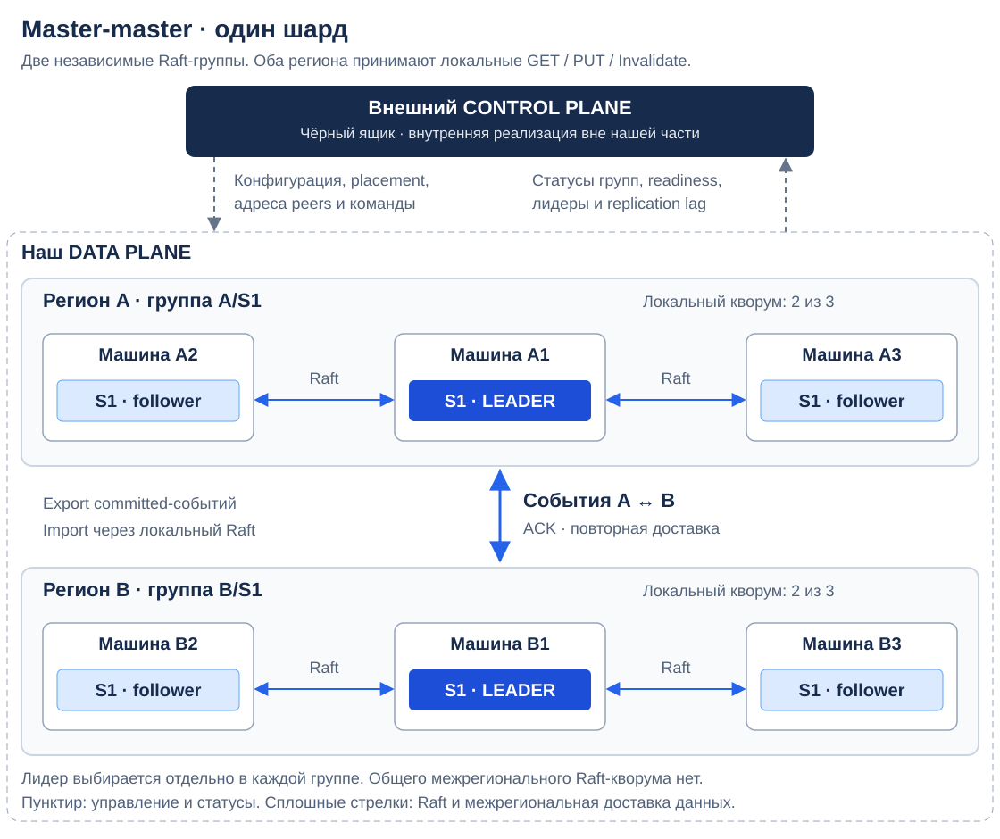
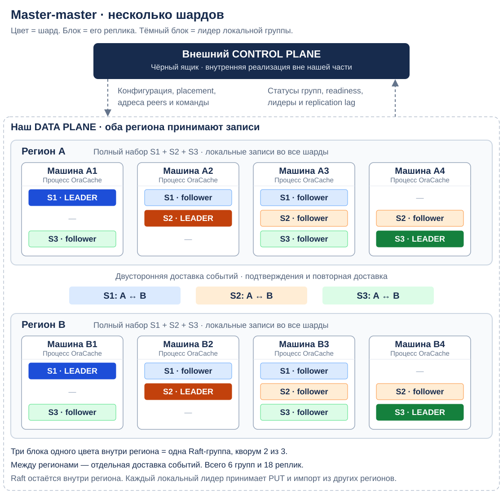
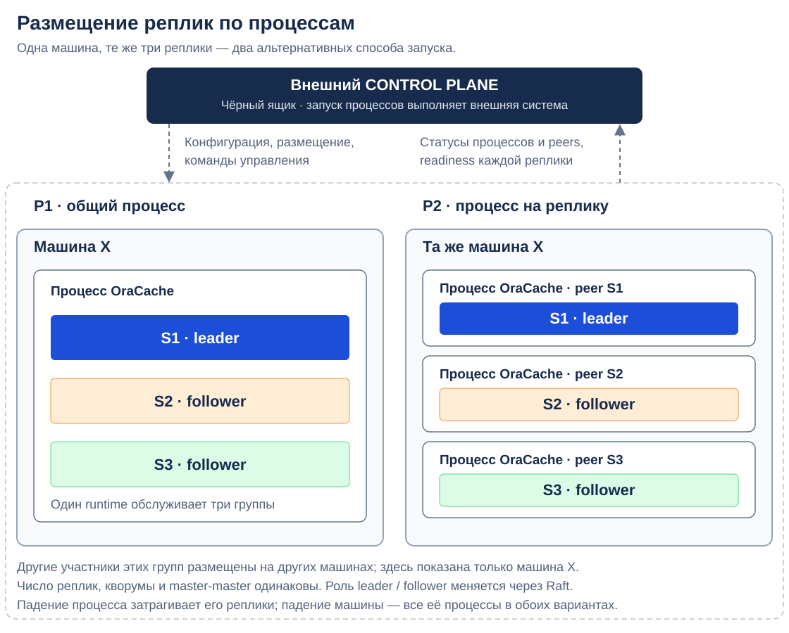

# OraCache: master-master и региональные Raft-группы

Статус: master-master выбран; детали протокола — черновик. Дата: 29.10.2026.

Документ описывает нашу часть data plane: устройство регионов, Raft-группы, двустороннюю репликацию и восстановление. Control plane разрабатывает другой участник и рассматривается как внешний чёрный ящик. Правила разрешения конфликтов пока оставлены отдельным контрактом без подробного проектирования.

## 1. Принятая архитектура

**Каждый регион принимает чтения и записи для любого шарда.** Для каждой пары `(region_id, shard_id)` существует отдельная Raft-группа. Внутри группы один лидер; между регионами — master-master.

Два уровня репликации:

- **Внутри региона:** Raft фиксирует команды на локальном кворуме, выбирает лидера и восстанавливает реплики.
- **Между регионами:** committed-изменения передаются в обе стороны. Получатель фиксирует импорт через свой локальный Raft.

Мастер-регион для шарда не назначается. Лидер A/S1 и лидер B/S1 одновременно принимают локальные записи, поскольку принадлежат разным группам. Между ними нет общего Raft-журнала или глобального кворума.

Базовый путь для прототипа — локальное подтверждение и асинхронный обмен между регионами. Дополнительный режим подтверждения после доставки во все регионы описан отдельно и не меняет master-master топологию.

Размещение реплик по процессам — отдельный выбор: сохраняем текущий вариант P1 «несколько групп в одном процессе на машине» и рассматриваем P2 «отдельный процесс на реплику шарда». Сравнение приведено в разделе 4.3; master-master, состав групп и протокол обмена одинаковы в обоих вариантах.

## 2. Требования и границы ответственности

Основа — [постановка проекта](initial-task.md) и уточнения из обсуждения:

- Каждый регион содержит полный набор данных кеша; внутри региона данные могут распределяться по нескольким машинам.
- В регионе несколько инстансов для отказоустойчивости. Первый стенд — два региона.
- Cache-aside: БД читает приложение; кеш самостоятельно к ней не обращается.
- PUT не содержит версии источника; внутренние версии формирует кеш.
- Данные восстанавливаются после падения, а новые реплики начинают обслуживать запросы после прогрева.
- Ориентир нагрузки: 10 000 чтений/с, 500 записей/с, запись около 10 КБ. Объём набора и распределение нагрузки по регионам ещё не заданы.

| Наша часть: data plane | Внешняя часть: control plane |
| --- | --- |
| Raft runtime, transport, журнал, snapshots | Конфигурация регионов, групп и адресов узлов |
| Локальное применение PUT/Invalidate и импорта | Желаемое размещение шардов и реплик |
| Export/import, подтверждения и позиции доставки | Планирование балансировки и изменений состава |
| Catchup, безопасное изменение membership | Команды создания групп, добавления/удаления реплик |
| Фактические роли, readiness, lag, ошибки | Потребление статусов и публикация готового размещения |

Источник инвалидаций и клиентская маршрутизация также внешние по отношению к Raft-компоненту. Здесь они представлены только входными запросами и необходимыми адресами/метаданными; их реализация не проектируется.

Control plane не выбирает лидера вместо Raft и не пересылает payload каждой записи. Его логический блок на схемах не означает один процесс или один общий кластер управления: внутренняя организация не задаётся.

## 3. Один шард: первый прототип

Весь набор ключей находится в S1. В каждом регионе три машины с репликами S1: всего две независимые Raft-группы и шесть реплик.

Как читать схему:

- A/S1 и B/S1 имеют собственных лидеров и локальные кворумы 2 из 3.
- Лидер A/S1 принимает PUT и инвалидации, пришедшие в A; лидер B/S1 делает то же для B.
- Межрегиональная стрелка — доставка событий и подтверждений. Это отдельный протокол, а не Raft-соединение между двумя лидерами.
- Входящие события также проходят через Raft принимающего региона.
- Пунктир связывает внешний control plane со всем data plane: конфигурация и команды в одну сторону, статусы и готовность — в другую.

При разрыве WAN оба региона могут продолжать локальные операции при наличии своих кворумов и доступного ресурса для backlog. После восстановления связи возобновляется обмен. Детали слияния конкурентных изменений вынесены в раздел 10.

Падение лидера вызывает выборы только в соответствующей региональной группе. Другому региону не нужно получать право записи: он уже принимает записи.

## 4. Несколько шардов на нескольких машинах

Разделим пространство ключей на S1, S2 и S3. **В каждом регионе находятся все три шарда**, но отдельная машина хранит только назначенные реплики.

Используется представление «машина → цветные реплики», похожее на [схемы TiKV](https://www.pingcap.com/blog/tidb-internal-data-storage/). Географические регионы на нашей схеме не следует путать с TiKV Region: в TiKV этим словом обозначается шард.

### 4.1. Машины и группы

На схеме показан вариант P1: карточка машины — один процесс OraCache. Цветной блок внутри — реплика шарда. Тёмный блок обозначает лидера локальной группы, светлый — follower. Альтернативное разделение на процессы показано в разделе 4.3.

| Шард | Группа в A | Группа в B | Межрегиональный обмен |
| --- | --- | --- | --- |
| S1 | A/S1: leader A1, followers A2/A3 | B/S1: leader B1, followers B2/B3 | A ↔ B |
| S2 | A/S2: leader A2, followers A3/A4 | B/S2: leader B2, followers B3/B4 | A ↔ B |
| S3 | A/S3: leader A4, followers A1/A3 | B/S3: leader B4, followers B1/B3 | A ↔ B |

Это шесть групп и восемнадцать реплик. Для каждого шарда записи принимаются в обоих регионах.

На A1 одновременно работают лидер S1 и follower S3; на A3 — три follower разных групп. После выборов роли могут поменяться без переноса данных на другие машины. Потеря A3 затронет три группы, но в каждой останутся две из трёх реплик.

Размещение в B симметрично только для простоты иллюстрации. Control plane может назначить другое количество машин и другое размещение при сохранении полной региональной копии и требований к числу реплик.

### 4.2. Независимость шардов и рост ёмкости

Для каждого шарда свои региональные журналы, позиции применения, исходящие события и snapshots. Между разными шардами нет общего порядка или атомарных транзакций.

Сбой S1 не требует останавливать S2 на уровне протокола. При этом общие CPU, диск и сеть машины требуют ограничений очередей и фонового трафика.

Полная копия нужна региону в совокупности. Если в регионе ровно три машины и у каждого шарда три реплики, каждая машина всё ещё хранит весь набор данных. Для роста полезной ёмкости нужны дополнительные машины и размещение групп на разных подмножествах узлов.

В первом прототипе допустим один шард, но `group_id` и `shard_id` должны присутствовать с начала в RPC, persistent state, snapshots и метриках. В P1 один процесс допускает несколько групп; в P2 процесс обслуживает одну реплику одной группы. Граница процесса и формат хранения WAL выбираются отдельно.

Первое расширение — фиксированный набор шардов и перемещение целых реплик. Динамические split/merge по типу TiKV остаются последующим расширением: нужны согласованные границы, версии маршрутизации и перенос межрегиональных потоков. Простое изменение `hash(key) % N` не заменяет миграцию.

### 4.3. Два варианта размещения реплик по процессам

**P1 — один процесс OraCache на машине, несколько реплик разных шардов внутри.** Это текущий вариант на общей схеме: процесс совместно использует ресурсы, но поддерживает отдельное Raft-состояние каждой группы.

**P2 — отдельный процесс OraCache на каждую локальную реплику шарда.** На машине одновременно работают несколько одинаковых по реализации инстансов с разными `group_id`, `peer_id`, адресами и каталогами данных. Каждый инстанс обслуживает одну группу: её Raft runtime, state machine, snapshots и export/import.

На схеме два альтернативных способа запустить одни и те же три реплики на условной машине X. Это не два дополнительных региона. Другие участники их Raft-групп находятся на других машинах и для краткости не показаны.

Процесс не запускается навсегда как «мастер» или «follower»: он является участником группы, а текущая роль меняется через Raft. Число групп, реплик данных и голосов не меняется при переходе между P1 и P2. Master-master между регионами также остаётся прежним.

| Аспект | P1: несколько групп в процессе | P2: процесс на реплику |
| --- | --- | --- |
| Код первого прототипа | Нужны диспетчеризация по группам, их запуск/остановка и управление общими ресурсами | Один экземпляр логики группы; проще локальный lifecycle |
| Падение процесса | Затрагивает все размещённые в нём реплики | Непосредственно затрагивает одну реплику |
| Перезапуск и обновление | Перезапуск процесса затрагивает несколько групп | Можно отдельно перезапускать или обновлять реплику |
| Отладка и fault injection | Нужны способы выделить конкретную группу внутри процесса | Можно остановить или ограничить конкретный процесс |
| Память и GC | Общий адресный простор; если используется GC, его работа влияет на общий процесс | Раздельные адресные пространства и, при наличии GC, отдельные heap/GC |
| CPU и память | Проще совместно использовать свободный бюджет; нужна внутренняя справедливость | Удобнее задавать лимиты по инстансам; свободный бюджет одного не всегда доступен другому |
| Фоновые задачи | Можно координировать snapshots, очереди и workers нескольких групп | У каждого процесса свои очереди и workers; нужны ограничения суммарной нагрузки на машину |
| Сеть и storage | Можно переиспользовать соединения, storage-кеши и объединять I/O | Больше независимых соединений, буферов, экземпляров storage и операций I/O |
| Эксплуатация | Меньше процессов, конфигураций и health endpoints | Больше запускаемых инстансов, адресов, каталогов и health checks |
| Рост числа шардов | Служебные ресурсы можно разделять между группами | Постоянные расходы процесса повторяются для каждой реплики |

P2, вероятно, упростит первую реализацию нашей Raft-части при небольшом числе шардов. Он не убирает необходимость реализовать durable storage, transport, snapshots, дедупликацию и межрегиональную доставку. P1 при этом не требует сразу повторять сложный batching TiKV: первый runtime может содержать несколько независимых компонентов реплик, а совместную обработку I/O можно добавлять позже.

### 4.4. Нюансы изоляции, ресурсов и управления

**Изоляция программных отказов.** В P2 аварийное завершение одной реплики не завершает соседние процессы. Однако без лимитов CPU, памяти и I/O тяжёлый snapshot или исчерпание ресурсов одним процессом может мешать всей машине. Разделение процессов само по себе не гарантирует изоляцию производительности или защиту от host-level OOM.

**Физические отказы.** Три процесса на одной машине не заменяют три независимые машины. Реплики одной Raft-группы по-прежнему размещаются на разных физических узлах. Падение машины одновременно затрагивает все её инстансы и в P1, и в P2. Контейнер также не создаёт новый физический домен отказа.

**Накладные расходы.** В P2 каждый процесс имеет собственные runtime, сетевые буферы, метрики и фоновые задачи; embedded storage может дополнительно иметь собственные кеши. При фиксированных лимитах памяти один инстанс может упираться в свой бюджет, пока другой использует лишь его часть. Величину накладных расходов нужно измерять на выбранной библиотеке и storage engine; преимущество P1 не является заранее доказанным числом RPS.

**Диск и идентичность.** В P2 задаются отдельные каталоги/пространства хранения реплик и исключается одновременный доступ двух процессов на запись к одному экземпляру storage, если движок не поддерживает такой режим явно. `peer_id` и данные сохраняются при обычном рестарте и не привязываются к PID. Потеря диска, создание новой реплики и перезапуск сохранившейся — разные операции.

**Обновления и перенос.** P2 позволяет перезапустить одну реплику, но совместимость версий протокола и сохранение кворума всё равно обязательны. Перемещение между машинами выполняется через learner/catchup и изменение membership, а не просто переносом или копированием процесса. В обоих вариантах readiness публикуется для каждой реплики: готовность одного процесса P1 не означает готовность всех его групп.

**Внешнее управление.** Для P2 нужен запуск, остановка и восстановление множества инстансов, привязка адресов/портов и persistent data, а также лимиты ресурсов. Это обязанность внешней системы запуска по контракту с control plane; она может использовать существующий supervisor или оркестратор. Её реализация остаётся за пределами нашей части. Отдельный контейнер на процесс возможен, но не обязателен.

Например, 12 шардов × 3 реплики = 36 реплик на регион. При равномерном размещении на шести машинах:

- P1: шесть процессов, каждый обслуживает в среднем шесть групп.
- P2: 36 процессов, в среднем по шесть на машине.

Объём полезных данных и число Raft-реплик одинаковы. В P2 увеличиваются служебные расходы и число управляемых процессов; в P1 сложнее внутреннее распределение ресурсов.

### 4.5. Общая граница реализации

Предлагается выделить компонент `ShardReplica`: одна локальная реплика группы с её Raft-состоянием, применением команд, snapshots и потоками репликации. Процесс — оболочка, запускающая один такой компонент в P2 или несколько в P1.

Идентичности `region_id`, `shard_id`, `group_id` и `peer_id` должны быть независимы от PID и упаковки по процессам. Для обоих вариантов протоколы и данные остаются привязанными к реплике, а не к процессу-хосту.

Это сохраняет возможность начать с P2 ради простоты и позднее объединить компоненты в P1. Объединение потребует работы над transport, storage и общими ресурсами; оно не считается бесплатным переключателем. P1 остаётся текущим вариантом схемы размещения, P2 добавлен как альтернатива; окончательный выбор пока не зафиксирован.

## 5. Путь записи и межрегиональный обмен

### 5.1. Локальная операция

Для PUT в регионе A:

1. Внешняя маршрутизация определяет шард и направляет запрос лидеру A/S.
2. Лидер предлагает команду в локальную Raft-группу.
3. После устойчивой фиксации кворумом команда применяется к state machine.
4. Вместе с применением сохраняется восстанавливаемое событие исходящего потока.
5. Отправитель доставляет его остальным регионам.

Для PUT в B путь полностью симметричен. Запрос не перенаправляется в другой регион только ради выбора единственного writer. Событийная инвалидация поступает через такой же путь локальной команды.

State machine включает локальное применение и точку интеграции общего правила слияния. Политика слияния не должна отличаться между узлами и регионами; её детализация отложена.

### 5.2. Идентичность событий и порядок

Предварительный идентификатор события:

`event_id = (origin_region, shard_id, stream_incarnation, sequence)`

- `origin_region` — регион, впервые принявший исходную операцию.
- `stream_incarnation` — идентичность поколения потока, сохраняемая при обычном рестарте и смене лидера.
- `sequence` — возрастающий номер исходных событий этого потока.
- Тип операции, ключ, значение PUT, `expires_at` и метаданные для слияния передаются в событии.

Номера создаются при детерминированном применении исходной committed-команды. Импорт не получает новый ID исходной операции. Смена Raft term не сбрасывает sequence и не создаёт новый поток.

У каждого получателя отдельный курсор для каждого origin-потока. Внутри потока события принимаются по порядку; пропуски вызывают повторную доставку. Между потоками A и B общего порядка нет. Идентификатор события сам по себе не задаёт свежесть данных или правило разрешения конфликтов.

### 5.3. Импорт и подтверждение

Получатель B передаёт события через `ImportBatch` в B/S. После durable commit и применения, включая обработку правилом слияния, он подтверждает непрерывную позицию origin-потока.

Применённое событие может не изменить итоговое значение, если оно проиграло конфликт. Подтверждение означает «операция надёжно обработана», а не «её payload обязательно является текущим значением ключа».

Дубликат не создаёт повторного эффекта и не продлевает TTL. Курсоры и необходимые данные дедупликации сохраняются вместе с состоянием.

Для первого прототипа предлагается прямая отправка исходных событий из каждого региона во все остальные. Импортированные события не превращаются в новые локальные события и не запускают бесконечную пересылку. Для двух регионов это два встречных потока на шард; для R регионов — R origin-потоков с доставкой каждому из остальных регионов.

### 5.4. Надёжность отправки

Исходящий поток — логический реплицируемый outbox. Изменение кеша и событие доставки должны восстанавливаться совместно: нельзя потерять событие при падении между применением PUT и отправкой.

Отправитель работает у текущего лидера локальной группы. После выборов новый лидер продолжает доставку; возможные повторы обрабатываются получателями. Курсоры подтверждений, влияющие на очистку outbox, сохраняются в реплицируемом состоянии.

Нужны ограничения batch size, запросов в полёте, памяти и дискового backlog. Недоступный регион догоняется по событиям или проходит resync. При исчерпании безопасного бюджета хранения допускается backpressure: ресурс для бесконечного разрыва WAN не предполагается.

## 6. Подтверждение записи и чтения

Master-master задаёт топологию приёма записей. Отдельно задаётся политика ACK.

| Режим | Условие успешного ответа | Назначение |
| --- | --- | --- |
| `LOCAL_DURABLE` | Durable commit и apply в регионе приёма; исходящее событие восстанавливаемо | Базовый режим: локальная задержка и асинхронная георепликация |
| `ALL_REGIONS_DURABLE` | Локальное условие плюс обработка события через Raft всех обязательных регионов | Дополнительная гарантия распространения подтверждённой операции |

ALL не делает независимые региональные журналы одной Raft-группой. Локальные эффекты могут стать видимы до завершения ожидания. Состав обязательных регионов фиксируется версией конфигурации; исключение недоступного региона не должно незаметно ослаблять условие успеха.

При таймауте операция могла уже примениться. Для безопасного повтора нужен request ID или проверка статуса — клиентский контракт уточняется отдельно. Внутренние повторы доставки сохраняют event ID обязательно.

Базовые чтения — с готовой локальной реплики, из её применённого состояния. Это eventual consistency: follower и удалённые origin-потоки могут отставать. В дальнейшем возможно ожидание конкретного события или набора позиций origin-потоков перед чтением. ReadIndex региональной группы проверяет её локальное состояние, но не подтверждает получение всех удалённых изменений.

## 7. Устройство узла, персистентность и восстановление

### 7.1. Локальный runtime

Процесс-хост запускает один компонент `ShardReplica` в P2 или несколько в P1. Его состав:

- Приём запросов и маршрутизацию Raft-сообщений по `group_id`.
- Raft runtime одной или нескольких групп и локальный transport.
- Устойчивый журнал и служебное Raft-состояние.
- State machine кеша с применением локальных и импортированных операций.
- Export/import workers и курсоры origin-потоков.
- Создание и установку snapshots, catchup и публикацию readiness.
- Адаптер управления и статусов для внешнего control plane.

Выбор лидера и membership независимы для каждой группы. Обслуживание записей и heartbeat должно получать ресурсы даже во время фоновой передачи snapshots.

Если реализация будет на Go, кандидат — [etcd/raft](https://github.com/etcd-io/raft). Библиотека даёт алгоритм консенсуса; transport, disk I/O и применение state machine интегрируем мы. Язык, библиотека и storage engine пока не утверждены.

### 7.2. Что сохраняем

Сохраняются Raft log, term/vote и конфигурация согласно контракту библиотеки; snapshot с applied position; данные кеша и служебные метаданные; исходящий поток; курсоры полученных и подтверждённых событий; необходимая дедупликация.

Raft ack опирается на устойчивое хранение. RAM-состояние восстанавливается из согласованного snapshot и журнала до включения реплики в обслуживание. Snapshot содержит данные и соответствующие им позиции потоков, а не независимо снятые значения.

`expires_at` входит в исходную команду и сохраняется при импорте/повторе. Детерминированное применение не должно зависеть от случайного времени replay. Политика логического истечения, вытеснения и хранения метаданных удаления уточняется с компонентом кеша.

### 7.3. Новая реплика и восстановление региона

Новая локальная реплика добавляется как learner, получает snapshot и догоняет журнал своей группы. Повышение до voter и готовность обслуживать чтения — разные состояния. Data plane сообщает достигнутые позиции и readiness, а внешняя часть использует это для включения реплики в обслуживание.

Восстановление целого региона использует межрегиональный логический snapshot с позициями origin-потоков и последующую доставку событий. Нельзя устанавливать raw Raft snapshot A/S как snapshot B/S: группы имеют разные журналы и membership.

Для master-master восстановление также должно сохранять собственные локальные изменения возвращающегося региона. Заменять его состояние удалённой копией без их учёта нельзя. Конкретный протокол merge snapshot + local changes будет определён вместе с правилом слияния; пока закладываем соответствующую границу в export/import.

Пока данные не достигли согласованной контрольной точки, реплика не объявляется READY. Передача snapshot и catchup ограничиваются по полосе и I/O.

## 8. Зависимости от внешнего control plane

На схемах control plane показан одним тёмным блоком за пределами нашей части. Рассматриваем только контракт взаимодействия:

| Направление | Передаваемые данные / действия |
| --- | --- |
| Control plane → data plane | Идентичности регионов, шардов, групп, peers и адреса соединений |
| Control plane → data plane | Желаемый состав реплик, версия конфигурации и список регионов для доставки |
| Control plane → data plane | Создание группы, добавление learner, повышение/удаление peer, запрос переноса лидерства |
| Data plane → control plane | Фактический состав группы, текущий лидер и term |
| Data plane → control plane | Commit/apply, позиции origin-потоков, lag и состояние snapshot/catchup |
| Data plane → control plane | Readiness, ошибки и результат выполнения команды управления |

Для выбора P1/P2 дополнительно нужна привязка `peer_id → process/instance → physical host` и endpoint каждой реплики. В P1 несколько peers могут использовать один endpoint с маршрутизацией по `group_id`; в P2 у инстансов отдельные endpoints либо внешний механизм маршрутизации. Readiness сообщается по peer в обоих случаях. Запуск, остановка процессов и подключение persistent data выполняются внешней системой запуска, без проектирования её устройства в этом документе.

Изменяющая команда имеет идентификатор и ожидаемую версию конфигурации. «Принято» и «выполнено» — разные статусы.

Control plane решает, где разместить реплику. Data plane выполняет перенос через bootstrap/catchup и штатное изменение membership Raft. Прямая подмена списка peers вместо протокола изменения состава не допускается.

События кеша передаются между data-plane узлами напрямую. Control plane не находится на пути каждого PUT или каждого export-события. Существующие группы продолжают работу по последней согласованной конфигурации при его временной недоступности; создание групп и изменения размещения могут ждать.

Механизмы discovery, балансировки, хранения метаданных и отказоустойчивости самого control plane здесь не определяются.

## 9. Поведение при отказах

| Событие | Ожидаемое поведение |
| --- | --- |
| Потеря одного узла из трёх в региональной группе | Локальный кворум сохраняется; при необходимости проходят выборы |
| Потеря лидера | Новый локальный лидер восстанавливает обслуживание и отправку событий |
| Потеря локального большинства | Эта группа не подтверждает новые записи; другие региональные группы продолжают работу |
| Разрыв WAN | Оба региона продолжают LOCAL-записи при наличии локальных ресурсов; новые ALL-операции не получают успех без удалённых подтверждений |
| Потеря целого региона | Остальные уже имеют право записи и продолжают работу; передача данных отсутствующему региону откладывается |
| Возвращение региона | Catchup или resync, обработка накопленных изменений, публикация readiness |
| Временная недоступность control plane | Работа по текущей конфигурации; изменения состава/размещения ожидают восстановления |

Локально подтверждённые, но ещё не отправленные изменения могут быть потеряны при уничтожении всех их durable-копий. Условие ALL сильнее по распространению, но не меняет механизм локальных выборов.

## 10. Открытые детали: пока без углубления

Master-master — принятое направление, а не вариант для выбора. Для следующего этапа оставляем короткий список:

1. **Слияние PUT и инвалидаций:** единое детерминированное правило для всех регионов; формат сравниваемой версии/causal metadata пока не выбран.
2. **Старый прогрев:** версия, назначенная кешем при получении PUT, не определяет свежесть значения БД. Возможность fill token обсудим с заказчиком позже.
3. **Межрегиональный snapshot и очистка истории:** как объединять восстановленное состояние с локальными изменениями и когда удалять outbox/tombstones.
4. **Публичные гарантии:** основной ACK-режим, допустимое отставание, поддержка request ID и ожидания позиций клиентом.
5. **Ресурсы:** объём кеша, хранение полной копии в RAM или RAM+disk, предел backlog и политика при его заполнении.
6. **Упаковка по процессам:** P1 или P2 для первого стенда с несколькими шардами; бюджет памяти/CPU на инстанс и контракт с внешней системой запуска.

Эти пункты не меняют изображённую топологию. Пока документ фиксирует компоненты и связи; он не объявляет проблему конфликтов уже решённой.

## 11. Этапы реализации и проверка

1. Одна региональная группа: PUT/Invalidate, WAL, snapshots, crash recovery и чтение применённого состояния.
2. Второй регион: оба локальных лидера принимают запись, двусторонние export/import, event ID, курсоры, дедупликация и точка интеграции merge.
3. Интеграция с внешним control plane: команды membership, статусы и готовность.
4. Восстановление региона и проверка сходимости после определения правила слияния.
5. Несколько шардов на машинах с выбранным размещением P1/P2, нагрузочные измерения и chaos-сценарии.

Основные проверки: падение лидера до/после commit; падение после локального apply до export; повторы и пропуски событий; одновременные записи в A и B; разрыв WAN; возвращение региона; добавление learner; недоступность control plane.

При сравнении P1/P2 фиксируем одинаковые группы, размещение, нагрузку и объём данных. Измеряем суммарные RSS/CPU, число соединений, дисковую нагрузку и p95/p99, в том числе во время snapshot. Отдельно проверяем падение одного процесса и всей машины. Наблюдаемость должна сохранять `group_id`/`peer_id` независимо от количества процессов.

Метрики нашей части: p95/p99 local commit и полного ответа, commit→apply, elections, WAL fsync, backlog export, lag по origin-потокам, snapshot duration, время до READY, повторы и ошибки. Hit rate и свежесть относительно БД измеряются совместно с компонентом кеша и тестовым источником.

Ориентировочный полезный поток при общей нагрузке 500 × 10 КБ — 5 МБ/с изменений. Прямая доставка в R−1 других регионов умножает межрегиональный объём на R−1; локальная Raft-репликация, snapshots и повторы учитываются дополнительно. Если нагрузка задана на каждый регион, расчёт нужно масштабировать.

## 12. Архитектурные ориентиры

- [TiKV](https://tikv.org/docs/6.1/reference/architecture/overview/): шард как единица Raft-репликации и восстановления, несколько групп на узле. Наша георепликация отдельно соединяет региональные группы.
- [Helix](https://helix.apache.org/Architecture.html): разделение управления размещением и исполнения жизненного цикла реплик. Внутреннее устройство control plane находится за границей документа.
- [Olric](https://github.com/olric-data/olric#architecture): пример распределённого кеша и размещения партиций. Его протокол репликации не является выбранным протоколом OraCache.

Схемы и протоколы выше описывают проект OraCache; это не утверждение о master-master гарантиях перечисленных продуктов.
