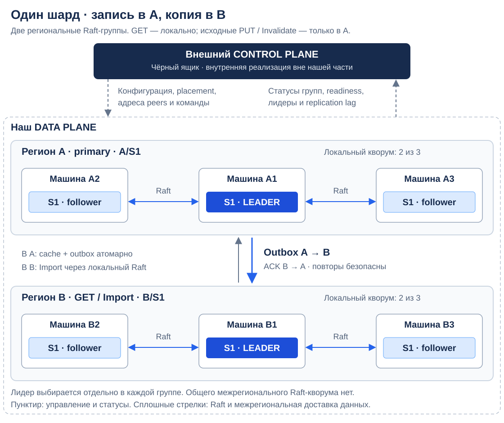
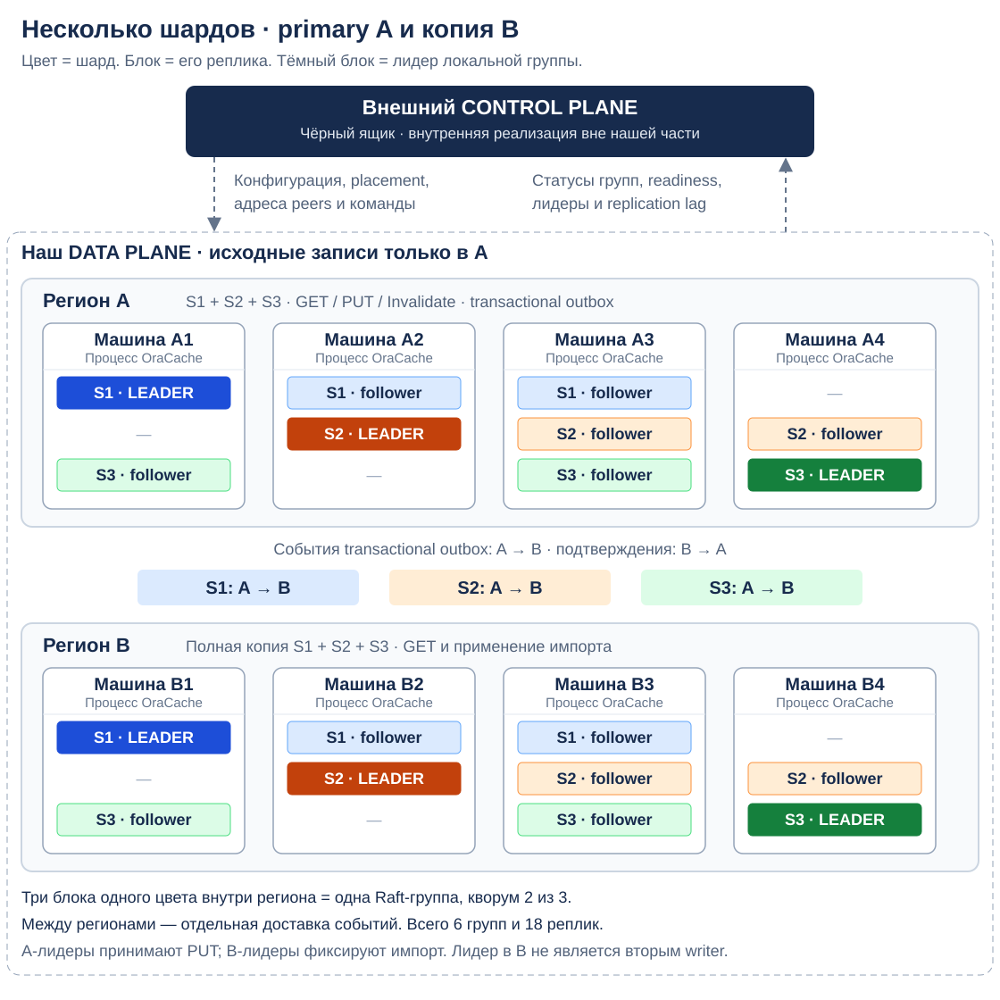
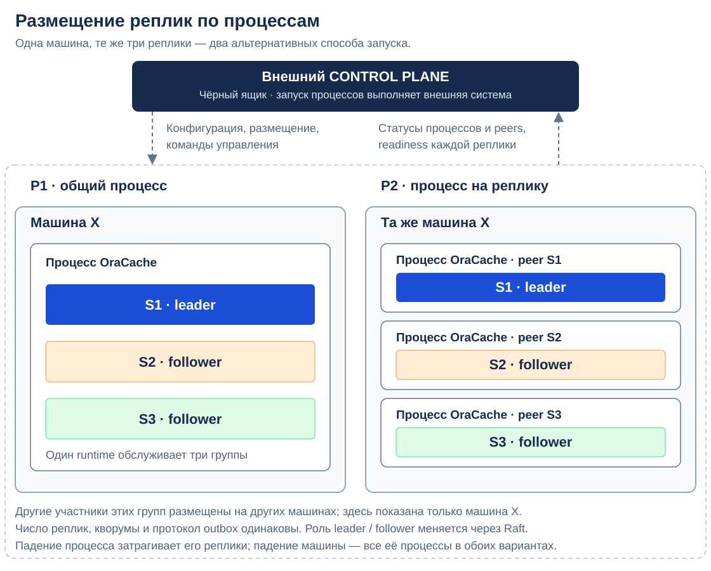

# OraCache: региональные Raft-группы и transactional outbox

Статус: master-master отменён по уточнению 01.11.2026; проектируем одного writer-региона для каждого шарда. Протокол и границы гарантий — черновик.

Общая схема control plane, gateway и хранилища, конкретное размещение сервисов и сценарии GET/PUT/добавления/вывода узлов описаны в [примере топологии](distributed-cache-topology.md). Этот документ сохраняет детали Raft, восстановления и сравнение вариантов процессов P1/P2.

## 1. Принятая модель и допущения

Для каждой пары `(region_id, shard_id)` существует отдельная Raft-группа. Но **исходные PUT и Invalidate конкретного шарда принимает только его primary region**. Остальные региональные группы обслуживают чтения и применяют импорт.

В конкретном примере primary region для всех S1–S3 — A; B содержит полную копию всех шардов. Это допущение примера, а не дополнительное согласованное требование заказчика. Поле `primary_region` хранится в политике шарда; глобального независимого writer в B нет.

- Внутри региона — Raft, локальные выборы и кворум.
- Между регионами — асинхронная доставка событий из transactional outbox primary-группы.
- Ответы ACK идут обратно. Это не двусторонний поток исходных изменений.
- Gateway любого региона принимает клиентский PUT, но направляет его в primary region.
- Лидер B/S1 нужен для упорядоченного применения импорта внутри B. Наличие этой роли не даёт права принимать исходные изменения S1.

Gateway и CP не являются voters или learners Raft-групп данных. Они узнают актуальное размещение и лидерство через отчёты CP Agent и обновления маршрутизации. Metadata State Store control plane может использовать собственный Raft; это отдельный кластер.

Основной режим — `PRIMARY_DURABLE`: успех после устойчивой локальной фиксации в primary region. Дополнительный `ALL_REGIONS_DURABLE` ждёт обработки события всеми обязательными регионами.

## 2. Требования и зона ответственности

Основа — [постановка проекта](initial-task.md), уточнения заказчика и обсуждение от 01.11.2026:

- Полный логический набор кеша в каждом регионе, с возможным отставанием асинхронной копии.
- Cache-aside: источник читает приложение; кеш сам к БД не обращается.
- PUT не содержит версии источника; локальная версия кеша не доказывает свежесть payload.
- Восстановление после падения и прогрев до включения реплики в обслуживание.
- Несколько шардов и несколько реплик на разных физических узлах.
- Ориентир 10 000 чтений/с, 500 записей/с, значение около 10 КБ; объём набора и требуемые задержки ещё уточняются.

Наша часть: Raft runtime, transport, журнал, применение команд, outbox/import, snapshots, catchup, безопасные membership-операции и статус каждой реплики. CP определяет желаемое размещение и планирует изменения; внешний supervisor запускает процессы. Gateway использует локальную карту маршрутов и работает с data plane напрямую.

## 3. Один шард

Весь набор ключей — S1. В каждом регионе группа из трёх реплик на разных машинах.

A/S1 принимает исходные команды. B/S1 принимает только импорт A/S1 и обслуживает чтения. Лидер каждой группы выбирается независимо; регион записи от этих выборов не меняется. PUT, пришедший в B, проходит через gateway в A.

При потере связи A продолжает PRIMARY-записи в пределах ресурсов outbox. B может обслуживать разрешённые отстающие чтения, но не становится новым writer. Автоматический failover primary region не предполагается без отдельного протокола передачи полномочий.

## 4. Несколько шардов и варианты процессов

Каждый регион содержит S1, S2 и S3, хотя одна машина хранит только назначенные реплики.

### 4.1. Машины и группы

В базовом варианте P1 на машине один процесс OraCache. Тёмный блок — лидер локальной группы, светлый — follower. В B все группы остаются read/import-only относительно исходных клиентских изменений.

| Шард | Группа в A | Группа в B | Primary / поток |
| --- | --- | --- | --- |
| S1 | A1 — leader; A2, A3 — followers | B1 — leader; B2, B3 — followers | A / A → B |
| S2 | A2 — leader; A3, A4 — followers | B2 — leader; B3, B4 — followers | A / A → B |
| S3 | A4 — leader; A1, A3 — followers | B4 — leader; B1, B3 — followers | A / A → B |

Всего шесть групп и восемнадцать реплик. Лидерство на схеме — текущий снимок, а не фиксированное назначение CP. Потеря A3 затрагивает три группы, но в каждой остаются две реплики.

### 4.2. Рост ёмкости

Группы имеют независимые журналы, apply-позиции, snapshots и межрегиональные потоки; общего порядка между шардами нет. На одном узле ресурсы общие, поэтому нужны ограничения очередей и фонового I/O.

Если машин ровно три и replication factor каждого шарда равен трём, каждая машина хранит весь набор данных. Для роста полезной ёмкости нужны дополнительные машины и размещение групп на разных подмножествах узлов.

`region_id`, `group_id`, `shard_id` и `peer_id` вводятся с первого прототипа. В P1 процесс обслуживает несколько групп, в P2 — одну локальную реплику. Первое расширение — фиксированные шарды и перенос целых peers. Динамические split/merge и изменение отображения ключей в шарды требуют отдельного протокола; простое изменение `hash(key) % N` не является миграцией.

### 4.3. Два варианта размещения реплик по процессам

**P1 — один процесс OraCache на машине, несколько реплик разных шардов внутри.** Это текущий вариант на общей схеме: процесс совместно использует ресурсы, но поддерживает отдельное Raft-состояние каждой группы.

**P2 — отдельный процесс OraCache на каждую локальную реплику шарда.** На машине одновременно работают несколько одинаковых по реализации инстансов с разными `group_id`, `peer_id`, адресами и каталогами данных. Каждый инстанс обслуживает одну группу: её Raft runtime, state machine, snapshots и export/import.

На схеме два альтернативных способа запустить одни и те же три реплики на условной машине X. Это не два дополнительных региона. Другие участники их Raft-групп находятся на других машинах и для краткости не показаны.

Процесс не запускается навсегда как «мастер» или «follower»: он является участником группы, а текущая роль меняется через Raft. Число групп, реплик данных и голосов не меняется при переходе между P1 и P2. Межрегиональная репликация через единственный регион записи и outbox также остаётся прежней.

| Аспект | P1: несколько групп в процессе | P2: процесс на реплику |
| --- | --- | --- |
| Код первого прототипа | Нужны диспетчеризация по группам, их запуск/остановка и управление общими ресурсами | Один экземпляр логики группы; проще локальный lifecycle |
| Падение процесса | Затрагивает все размещённые в нём реплики | Непосредственно затрагивает одну реплику |
| Перезапуск и обновление | Перезапуск процесса затрагивает несколько групп | Можно отдельно перезапускать или обновлять реплику |
| Отладка и fault injection | Нужны способы выделить конкретную группу внутри процесса | Можно остановить или ограничить конкретный процесс |
| Память и GC | Общий адресный простор; если используется GC, его работа влияет на общий процесс | Раздельные адресные пространства и, при наличии GC, отдельные heap/GC |
| CPU и память | Проще совместно использовать свободный бюджет; нужна внутренняя справедливость | Удобнее задавать лимиты по инстансам; свободный бюджет одного не всегда доступен другому |
| Фоновые задачи | Можно координировать snapshots, очереди и workers нескольких групп | У каждого процесса свои очереди и workers; нужны ограничения суммарной нагрузки на машину |
| Сеть и storage | Можно переиспользовать соединения, storage-кеши и объединять I/O | Больше независимых соединений, буферов, экземпляров storage и операций I/O |
| Эксплуатация | Меньше процессов, конфигураций и health endpoints | Больше запускаемых инстансов, адресов, каталогов и health checks |
| Рост числа шардов | Служебные ресурсы можно разделять между группами | Постоянные расходы процесса повторяются для каждой реплики |

P2, вероятно, упростит первую реализацию нашей Raft-части при небольшом числе шардов. Он не убирает необходимость реализовать durable storage, transport, snapshots, дедупликацию и межрегиональную доставку. P1 при этом не требует сразу повторять сложный batching TiKV: первый runtime может содержать несколько независимых компонентов реплик, а совместную обработку I/O можно добавлять позже.

### 4.4. Нюансы изоляции, ресурсов и управления

**Изоляция программных отказов.** В P2 аварийное завершение одной реплики не завершает соседние процессы. Однако без лимитов CPU, памяти и I/O тяжёлый snapshot или исчерпание ресурсов одним процессом может мешать всей машине. Разделение процессов само по себе не гарантирует изоляцию производительности или защиту от host-level OOM.

**Физические отказы.** Три процесса на одной машине не заменяют три независимые машины. Реплики одной Raft-группы по-прежнему размещаются на разных физических узлах. Падение машины одновременно затрагивает все её инстансы и в P1, и в P2. Контейнер также не создаёт новый физический домен отказа.

**Накладные расходы.** В P2 каждый процесс имеет собственные runtime, сетевые буферы, метрики и фоновые задачи; embedded storage может дополнительно иметь собственные кеши. При фиксированных лимитах памяти один инстанс может упираться в свой бюджет, пока другой использует лишь его часть. Величину накладных расходов нужно измерять на выбранной библиотеке и storage engine; преимущество P1 не является заранее доказанным числом RPS.

**Диск и идентичность.** В P2 задаются отдельные каталоги/пространства хранения реплик и исключается одновременный доступ двух процессов на запись к одному экземпляру storage, если движок не поддерживает такой режим явно. `peer_id` и данные сохраняются при обычном рестарте и не привязываются к PID. Потеря диска, создание новой реплики и перезапуск сохранившейся — разные операции.

**Обновления и перенос.** P2 позволяет перезапустить одну реплику, но совместимость версий протокола и сохранение кворума всё равно обязательны. Перемещение между машинами выполняется через learner/catchup и изменение membership, а не просто переносом или копированием процесса. В обоих вариантах readiness публикуется для каждой реплики: готовность одного процесса P1 не означает готовность всех его групп.

**Внешнее управление.** Для P2 нужен запуск, остановка и восстановление множества инстансов, привязка адресов/портов и persistent data, а также лимиты ресурсов. Это обязанность внешней системы запуска по контракту с control plane; она может использовать существующий supervisor или оркестратор. Её реализация остаётся за пределами нашей части. Отдельный контейнер на процесс возможен, но не обязателен.

Например, 12 шардов × 3 реплики = 36 реплик на регион. При равномерном размещении на шести машинах:

- P1: шесть процессов, каждый обслуживает в среднем шесть групп.
- P2: 36 процессов, в среднем по шесть на машине.

Объём полезных данных и число Raft-реплик одинаковы. В P2 увеличиваются служебные расходы и число управляемых процессов; в P1 сложнее внутреннее распределение ресурсов.

### 4.5. Общая граница реализации

Предлагается выделить компонент `ShardReplica`: одна локальная реплика группы с её Raft-состоянием, применением команд, snapshots и потоками репликации. Процесс — оболочка, запускающая один такой компонент в P2 или несколько в P1.

Идентичности `region_id`, `shard_id`, `group_id` и `peer_id` должны быть независимы от PID и упаковки по процессам. Для обоих вариантов протоколы и данные остаются привязанными к реплике, а не к процессу-хосту.

Это сохраняет возможность начать с P2 ради простоты и позднее объединить компоненты в P1. Объединение потребует работы над transport, storage и общими ресурсами; оно не считается бесплатным переключателем. P1 остаётся текущим вариантом схемы размещения, P2 добавлен как альтернатива; окончательный выбор пока не зафиксирован.

## 5. Запись, transactional outbox и импорт

### 5.1. Атомарная граница

Gateway направляет PUT/Invalidate лидеру primary-группы, передавая идентификатор запроса, шард и ожидаемую версию политики. Хранилище проверяет полномочия региона само: одной правильной маршрутизации недостаточно. На B исходный PUT отвергается с `WrongPrimary`; `ImportBatch` — отдельная авторизованная операция.

Одна committed-команда Raft при apply формирует:

1. Изменение значения/инвалидации и внутренней версии кеша.
2. Событие outbox с тем же результатом и позицией.
3. Результат дедупликации request ID и applied position.

Это **одна локальная атомарная граница**, а не две независимые записи «в кеш, затем в очередь». При дисковом state store нужен atomic write batch/transaction. При RAM-state + WAL нужен согласованный replay, восстанавливающий данные, событие и позиции вместе. Экспорт разрешён только для committed и применённых событий.

Термин transactional outbox относится здесь к состоянию кеша и его исходящему событию. Он не означает общую транзакцию с первичной БД приложения и не требует SQL, Kafka или отдельного брокера. Принцип атомарности и необходимости идемпотентного получателя соответствует [описанию transactional outbox](https://docs.aws.amazon.com/prescriptive-guidance/latest/cloud-design-patterns/transactional-outbox.html).

### 5.2. Порядок событий

Идентификатор потока: `(shard_id, writer_epoch)`; событие дополнительно содержит монотонный `sequence`, request/event ID, операцию, ключ, payload PUT и абсолютный `expires_at`.

`writer_epoch` — поколение полномочий региона записи, не Raft term и не версия конфигурации CP. Смена локального лидера не меняет epoch и не сбрасывает sequence. В примере epoch фиксирован, смена primary не автоматизирована.

Получатель принимает события текущего допустимого writer, применяет непрерывный префикс и не перескакивает через пропуски. Повторы не дают повторного эффекта. Общий merge независимых writers больше не нужен.

### 5.3. Передача

Sender работает у текущего лидера primary-группы, читает outbox и находит группу назначения по региональному каталогу CP. Receiver на лидере B/S предлагает `ImportBatch` своему Raft.

После durable commit и apply B возвращает `(shard, epoch, applied_sequence)`. A сохраняет подтверждённый курсор в реплицируемом состоянии, после чего события можно очищать по политике retention. При потере ACK событие придёт повторно. Импорт не создаёт новый исходящий PUT, поэтому цикл A → B → A не возникает.

Смена лидера A возобновляет отправку из сохранённого outbox; смена лидера B обрабатывается через leader hint, обновление каталога и повтор. Событие может быть покрыто более поздним snapshot/состоянием: ACK не обещает, что его значение до сих пор последнее.

### 5.4. Backlog и восстановление

Нужны лимиты batch, операций в полёте, памяти, диска и snapshot-трафика. При длительном отставании B получает логический snapshot с позицией P и события P+1 далее. Такой snapshot содержит актуальные данные и необходимые метаданные удаления, TTL и дедупликации.

Raw Raft snapshot A/S нельзя установить в B/S: разные membership и индексы журналов. Установка экспортного snapshot и курсора выполняется согласованно в принимающей группе, а затем публикуется readiness.

Retention outbox должен оставлять путь восстановления. При исчерпании безопасного бюджета записи могут получить backpressure. Разрыв WAN не предполагается бесконечным.

## 6. Подтверждения и чтения

| Режим | Условие успеха |
| --- | --- |
| `PRIMARY_DURABLE` | Durable commit и apply в primary-группе; данные и outbox восстанавливаемы |
| `ALL_REGIONS_DURABLE` | Условие PRIMARY плюс обработка события всеми регионами из закреплённой конфигурации |

Для клиента в B PRIMARY уже включает WAN до A. ALL не делает видимость атомарной во всех регионах и не заставляет каждый follower немедленно применить запись. После таймаута результат может быть неизвестен; внутренние повторы сохраняют ID.

Для конкретной топологии GET направляется **локальному лидеру** готовой группы: это упрощает маршрутизацию и исключает дополнительное локальное follower-отставание из базового сценария. Регион B всё равно может отставать от A. ReadIndex и ожидание apply дают актуальность только относительно журнала выбранной региональной группы.

Чтение произвольного follower можно добавить отдельным режимом. Для read-your-writes после PUT в A gateway B должен дождаться нужного `(writer_epoch, sequence)` в B или явно направить чтение в A. Базовый eventual GET этого не обещает.

## 7. Runtime, персистентность и восстановление peer

Процесс-хост запускает один `ShardReplica` в P2 или несколько в P1. Компонент содержит Raft runtime, storage, state machine, outbox либо import, snapshots/catchup и интерфейс CP Agent.

При реализации на Go кандидат — [etcd/raft](https://github.com/etcd-io/raft); transport, persistence и apply интегрируем мы. Хранятся log, term/vote, membership, snapshot/applied position, данные, outbox, курсоры и дедупликация. Только RAM без durable backing не даёт восстановления после полного рестарта.

`expires_at` передаётся неизменным при импорте и повторах. Replay не должен принимать разные логические решения из-за текущего времени узла. Семантика TTL/eviction согласуется с компонентом кеша и требованием полной копии.

Новая реплика входит как learner, догоняет snapshot и журнал **своей региональной группы**, затем может стать voter. Readiness фиксируется по контрольной позиции и выбранному пределу отставания; требовать постоянного буквального lag=0 при продолжающейся записи не нужно.

Плановое перемещение: добавить learner → дождаться догона → безопасно изменить voters → подтвердить исключение старого peer → удалить только его локальные данные. Donor snapshot не обязательно является удаляемой репликой. Конкретные примеры приведены в общем документе.

## 8. Связь с control plane и gateway

Используем роли из приложенного описания CP: CP Agent, State Store, Health Aggregator, Scheduler, Controller/Reconciler, Command Dispatcher; supervisor — внешний.

- CP Agent внутри storage-процесса регистрирует host/endpoint и сообщает состояние **каждого peer**: роль, term, committed membership, apply/catchup и readiness.
- CP хранит отдельно desired placement и observed state, публикует версионированный каталог.
- Gateway получает snapshot каталога и push-обновления с pull-resync; на обычном GET/PUT использует локальную копию.
- Sender получает remote group/peer endpoints и подсказку лидера из каталога. Регионы не обнаруживаются самим Raft и не выводятся из клиентских запросов.
- CP не участвует в голосовании данных. Подсказка лидера может устареть; окончательная проверка роли и term выполняется data plane.
- Supervisor запускает процесс; Controller инициирует Raft membership через лидера. Desired config не подменяет committed membership.
- При недоступности CP существующие группы работают по последней принятой политике. Новые размещения могут ждать.

P1/P2 меняют привязку `peer → process → host`, но не протокол. Публичные описания RPC, источники метаданных и интервалы обновлений — в [общей топологии](distributed-cache-topology.md).

## 9. Отказы и изменение primary region

| Событие | Поведение |
| --- | --- |
| Один узел потерян | Группы с оставшимися 2/3 продолжают работу; при необходимости локальные выборы |
| Потерян локальный кворум | Соответствующая группа останавливает подтверждение новых команд |
| WAN A–B разорван | A принимает PRIMARY-записи до лимита backlog; B читает имеющуюся копию; PUT из B в A недоступен |
| Регион B потерян | A продолжает PRIMARY; ALL ждёт/завершается таймаутом |
| Primary region A потерян | Новые исходные записи остановлены; B не становится writer автоматически |
| Процесс/регион вернулся | Replay, catchup или resync, затем readiness |

Outbox не обеспечивает zero RPO при уничтожении A до доставки хвоста в B. Возобновить запись в B можно только отдельной процедурой передачи полномочий: исключить работающий старый writer, выбрать восстановимый префикс, зафиксировать новый epoch и обновить политику. Heartbeat timeout или увеличение `config_version` сами по себе не fencing. В данном примере автоматическая смена primary не заявляется.

Плановый вывод одной машины внутри A не является сменой primary region: группа переносит peer и при необходимости выбирает другого локального лидера.

## 10. Открытые детали

1. Пример использует A для записи всех шардов; допустимое отставание и условия смены primary нужно подтвердить.
2. Локальная версия не защищает от позднего PUT со старым значением БД; fill token отложен до обсуждения API.
3. Точный storage engine, retention outbox, условия установки snapshot и очистки tombstones.
4. P1/P2, размер рабочего набора и ресурсный бюджет.
5. ACK-режим, request ID, read-your-writes и пределы freshness.
6. Выбор и HA-организация State Store CP в примере — проектное допущение, а не утверждение исходного PDF.

## 11. Реализация и проверки

1. Локальная группа: durable PUT/Invalidate, atomic apply+outbox, replay и snapshots.
2. Вторая региональная группа: последовательный import, ACK, дедупликация и восстановление.
3. CP Agent, каталог gateway/sender, исправление устаревших маршрутов.
4. Добавление/вывод peer, readiness и интеграция с supervisor.
5. Несколько шардов, нагрузочные и chaos-проверки.

Проверять падение до/после commit и до отправки outbox; потерю ACK; пропуски/повторы; запрет исходного PUT на B; stale leader hint; смену лидера в обоих регионах; resync; learner/membership и отсутствие преждевременного удаления donor; недоступность CP.

При сравнении P1/P2 фиксировать одинаковое размещение и нагрузку, измерять суммарные RSS/CPU, I/O, соединения и p95/p99. Метрики протокола: commit→apply, WAL fsync, elections, outbox size/age, imported sequence, snapshot duration и time-to-ready.

500 × 10 КБ дают около 5 МБ/с полезных изменений при общей указанной нагрузке. Fan-out в R−1 копий умножает WAN-объём на R−1; локальный Raft, snapshots и повторы считаются отдельно. Эти оценки не заменяют sizing и benchmark.

## 12. Ориентиры

[TiKV](https://tikv.org/docs/6.1/reference/architecture/overview/) — шард как единица репликации и восстановления; [Helix](https://helix.apache.org/Architecture.html) — отделение desired placement от исполнения; [Olric](https://github.com/olric-data/olric#architecture) — организация распределённого кеша. Это архитектурные ориентиры, не выбранные готовые реализации OraCache.
