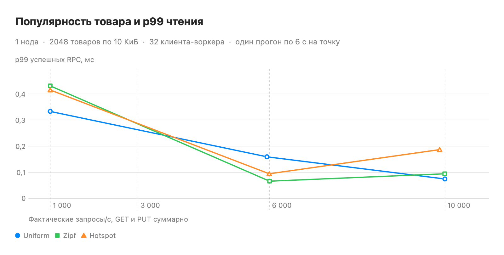
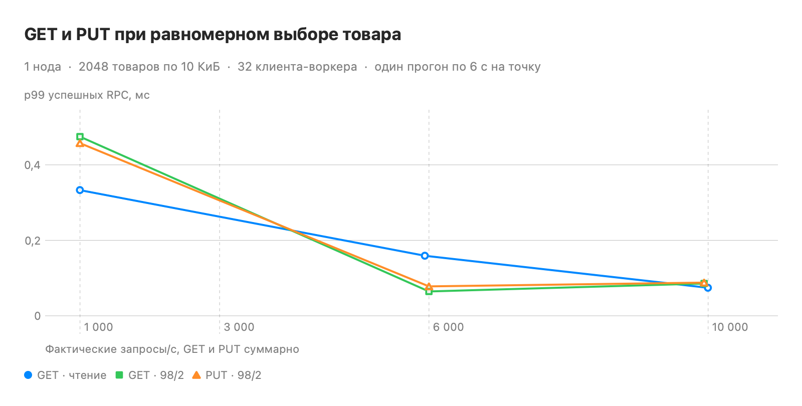

# Каталог интернет-магазина в OraCache

На MacBook Air M5 при целевых 10 000 GET/с одна нода обслужила равномерное чтение с p99 **0,074 мс** при **9996,5 фактических RPC/с**. В Hotspot 80/20 вышло **0,187 мс при 9877,7 RPC/с**, в Zipf с s=1,1 — **0,094 мс при 9991,2 RPC/с**. При 6000 целевых RPC/с порядок изменился. Одно короткое измерение каждой конфигурации подтверждает различие фактической нагрузки и времени ответа. Устойчивый штраф за популярность товара по этой серии установить нельзя.

Самое отчётливое различие по стадиям видно при смене числа реплик. В сценарии 90/10 на 1000 целевых RPC/с переход с одной на три ноды увеличил среднее ожидание ReadIndex с **1,2 до 206 мкс**, а наблюдаемого commit — с **3,5 до 247 мкс**. Время применения PUT оставалось около 10 мкс. При уменьшении размеров товаров на одной ноде снизились объём аллокаций и время копирования значения.

## Методика и воспроизведение

25 ноября 2026 года, Apple M5, 10 CPU, 16 ГиБ RAM, macOS 26.6 arm64, Go 1.27.3, Python 3.9.6. Нативные процессы на loopback. База рабочего дерева — `4adf16be3df80a305f43774bddb3a1f50ef720df`, с локальными изменениями профилирования. SHA, Go build info, версии и параметры находятся в `metadata.json` каждого прогона. Нагрузка и сервер работали на одном компьютере. Все основные сравнения используют direct gRPC к лидеру с linearizable read, 32 worker, один переиспользуемый канал, seed 1. Каждая строка соответствует свежему стенду и одному окну 6 с.

Базовый набор — 2048 ключей `product:<id>`, 10 240 байт на значение, всего 20 971 520 байт (20 МиБ полезных данных без накладных расходов и истории). Клиент последовательно подтверждает seed PUT, запоминает ревизии и с проверкой читает весь набор. После сигнала READY runner проверяет лидера и applied index всех реплик и открывает измерительное окно. При подготовке базового набора индекс снимка достигал 2000. В смешанных сценариях меняются цена, остаток и идентификатор записи у существующих товаров. Отдельное пространство `missing:product:<id>` остаётся пустым.

Для каждого порядкового номера план определяет операцию, ключ и ожидаемый промах. Параллельные worker могут завершить эти запросы в другом порядке. GET проверяет статус, размер, байты, принадлежность ключу и текущую ревизию. Результат сверяется с посевной версией или с точной парой write token и серверной ревизии успешного PUT после присоединения всех worker. Так GET может увидеть уже применённую запись до получения подтверждения другим worker. Неподтверждённая версия, повреждённые данные, неожиданный MISS и ошибки RPC попадают в ошибки.

Таймер запроса охватывает вызов gRPC-клиента. Подготовка данных и сверка байтов учитываются в занятости worker, но находятся вне его RPC latency. Перцентили nearest rank рассчитаны по валидным ответам каждой операции отдельно. Ожидаемый MISS учитывается среди успешных GET. Общий ticker теряет такты под нагрузкой. Дефицит слотов равен `max(0, target × seconds − отправлено)`, а actual RPS включает время до последнего завершения. Из-за coordinated omission графики описывают задержку **отправленных** RPC. Время в воображаемой очереди внешних запросов из этих данных восстановить нельзя.

```sh
python3 scripts/profiling/catalog_matrix.py
python3 scripts/profiling/catalog_matrix.py --rates 6000
python3 scripts/profiling/run.py catalog 1000 --nodes 3 --seconds 6 --get-percent 90 --phase profile
# Полная серия для самостоятельного запуска, три независимых повтора по 30 с
python3 scripts/profiling/catalog_matrix.py --full
```

Полная серия добавляет точку 3000 RPS и обе топологии для каждого основного сценария. Её длительные прогоны в результаты ниже не включены. Описание параметров, legacy-контроля и файлов измерений приведено в [инструкции запуска](../scripts/profiling/README.md).

## Клиентские результаты без профилирования

Фактический RPS в таблице суммирует GET и PUT. Во всех завершённых строках число ошибок равно нулю и успешный RPS равен фактическому. Столбцы GET и PUT показывают число вызовов. Ссылка каждой строки открывает JSON с раздельными throughput, mean, p50, p95, p99 и max. Пропуск означает отсутствие соответствующей операции.

| Сценарий | Нод | Цель RPC/с | Факт RPC/с | GET | PUT | Дефицит слотов | GET p99, мс | PUT p99, мс |
| --- | --- | --- | --- | --- | --- | --- | --- | --- |
| [Uniform](../.reports/profiling/20261125-135610-153202-1n-direct-linearizable-catalog-1000-baseline/catalog.json) | 1 | 1000 | 998.3 | 5990 | 0 | 10 | 0.333 | — |
| [Hotspot](../.reports/profiling/20261125-135619-393558-1n-direct-linearizable-catalog-1000-baseline/catalog.json) | 1 | 1000 | 999.3 | 5996 | 0 | 4 | 0.415 | — |
| [Zipf](../.reports/profiling/20261125-135627-343962-1n-direct-linearizable-catalog-1000-baseline/catalog.json) | 1 | 1000 | 999.3 | 5996 | 0 | 4 | 0.431 | — |
| [Uniform 98/2](../.reports/profiling/20261125-135635-313709-1n-direct-linearizable-catalog-1000-baseline/catalog.json) | 1 | 1000 | 999.1 | 5872 | 123 | 5 | 0.475 | 0.458 |
| [5% MISS](../.reports/profiling/20261125-135951-554628-1n-direct-linearizable-catalog-1000-baseline/catalog.json) | 1 | 1000 | 999.3 | 5996 | 0 | 4 | 0.397 | — |
| [Разные размеры](../.reports/profiling/20261125-140000-033215-1n-direct-linearizable-catalog-1000-baseline/catalog.json) | 1 | 1000 | 997.9 | 5988 | 0 | 12 | 0.395 | — |
| [Uniform 90/10](../.reports/profiling/20261125-140025-006183-1n-direct-linearizable-catalog-1000-baseline/catalog.json) | 1 | 1000 | 999.8 | 5396 | 603 | 1 | 0.339 | 0.353 |
| [Uniform 70/30](../.reports/profiling/20261125-140032-962518-1n-direct-linearizable-catalog-1000-baseline/catalog.json) | 1 | 1000 | 994.9 | 4186 | 1784 | 30 | 0.554 | 0.671 |
| [Uniform](../.reports/profiling/20261125-140138-016593-1n-direct-linearizable-catalog-6000-baseline/catalog.json) | 1 | 6000 | 5940.5 | 35646 | 0 | 354 | 0.159 | — |
| [Hotspot](../.reports/profiling/20261125-140146-394144-1n-direct-linearizable-catalog-6000-baseline/catalog.json) | 1 | 6000 | 5992.3 | 35957 | 0 | 43 | 0.094 | — |
| [Zipf](../.reports/profiling/20261125-140154-411963-1n-direct-linearizable-catalog-6000-baseline/catalog.json) | 1 | 6000 | 5999.3 | 35999 | 0 | 1 | 0.066 | — |
| [Uniform 98/2](../.reports/profiling/20261125-140203-446493-1n-direct-linearizable-catalog-6000-baseline/catalog.json) | 1 | 6000 | 5999.3 | 35266 | 733 | 1 | 0.064 | 0.078 |
| [Uniform](../.reports/profiling/20261125-135643-288648-1n-direct-linearizable-catalog-10000-baseline/catalog.json) | 1 | 10000 | 9996.5 | 59994 | 0 | 6 | 0.074 | — |
| [Hotspot](../.reports/profiling/20261125-135651-909703-1n-direct-linearizable-catalog-10000-baseline/catalog.json) | 1 | 10000 | 9877.7 | 59288 | 0 | 712 | 0.187 | — |
| [Zipf](../.reports/profiling/20261125-135700-485943-1n-direct-linearizable-catalog-10000-baseline/catalog.json) | 1 | 10000 | 9991.2 | 59972 | 0 | 28 | 0.094 | — |
| [Uniform 98/2](../.reports/profiling/20261125-135708-586657-1n-direct-linearizable-catalog-10000-baseline/catalog.json) | 1 | 10000 | 9941.6 | 58411 | 1255 | 334 | 0.086 | 0.088 |
| [Каталог магазина](../.reports/profiling/20261125-140007-954707-3n-direct-linearizable-catalog-1000-baseline/catalog.json) | 3 | 1000 | 999.6 | 5875 | 123 | 2 | 0.790 | 0.784 |
| [Uniform 90/10](../.reports/profiling/20261125-140308-533557-3n-direct-linearizable-catalog-1000-baseline/catalog.json) | 3 | 1000 | 999.1 | 5393 | 602 | 5 | 0.767 | 0.869 |
| [Uniform](../.reports/profiling/20261125-140016-304085-3n-direct-linearizable-catalog-10000-baseline/catalog.json) | 3 | 10000 | 9966.7 | 59834 | 0 | 166 | 0.426 | — |

Контроль исходным клиентом по одному ключу (10 КиБ, 2048 прогревочных чтений) дал 59 956 успешных GET, 9988,8 RPC/с, mean 0,049 мс и p99 0,152 мс на одной ноде. В основном сравнении распределений используется только режим каталога с одинаковыми границами таймера. [Исходный контроль](../.reports/profiling/20261125-140212-282944-1n-direct-linearizable-get-10000-baseline/summary.txt)

## Популярность и частота обновлений



На точке 10 000 RPS при Uniform все 2048 ключей получили по 29 или 30 GET. При Hotspot первые 410 товаров получили 47 306 из 59 288 GET (79,79%), на самый популярный пришлось 162 GET. При Zipf один товар получил 10 041 из 59 972 GET (16,74%), за окно обратились к 2015 разным товарам. На точке 1000 RPS при Zipf за 6 секунд прочитаны только 975 разных товаров, хотя прогрев охватил все 2048. [Uniform](../.reports/profiling/20261125-135643-288648-1n-direct-linearizable-catalog-10000-baseline/key-frequency.csv) · [Hotspot](../.reports/profiling/20261125-135651-909703-1n-direct-linearizable-catalog-10000-baseline/key-frequency.csv) · [Zipf](../.reports/profiling/20261125-135700-485943-1n-direct-linearizable-catalog-10000-baseline/key-frequency.csv)



В Uniform 98/2 при целевых 10 000 RPC/с чтения дали 9732,5 GET/с, записи — 209,1 PUT/с. Максимумы были 35,39 мс у GET и 33,68 мс у PUT при p99 меньше 0,09 мс у обеих операций. За это окно snapshot index вырос с 2000 до 3000. Совпадение длинных запросов с выполнением конкретного снимка потребовало бы трассировки этого же окна. В отдельном сценарии 70/30 при 1000 RPC/с снимок также продвинулся до 3000, максимальный успешный PUT занял 54,25 мс. [Распределения 98/2](../.reports/profiling/20261125-135708-586657-1n-direct-linearizable-catalog-10000-baseline/catalog.json) · [Индексы после 70/30](../.reports/profiling/20261125-140032-962518-1n-direct-linearizable-catalog-1000-baseline/node-1.after-load.json)

## Размеры и промахи

- В однофакторном Uniform с 5% заданных промахов получены 5689 HIT и 307 ожидаемых MISS из 5996 GET. Фактическая доля промахов — 5,12%. p99 всех успешных GET составил 0,397 мс, у контроля без промахов — 0,333 мс. Разные имена в существующем и отсутствующем пространствах объясняют 2335 уникальных запрошенных ключей при размере заполненного каталога 2048. [Результат промахов](../.reports/profiling/20261125-135951-554628-1n-direct-linearizable-catalog-1000-baseline/catalog.json)
- В другом однофакторном Uniform 1229 товаров имели размер 256 Б, 614 — 1024 Б, 205 — 10 240 Б. Полезные данные составили 3 042 560 байт. Все 5988 ответов прошли проверку. p99 составил 0,395 мс против 0,333 мс у контроля с 10 КиБ. В коротком baseline уменьшение объёма данных не дало выигрыша по p99, хотя разница в аллокациях и копировании видна в профилях ниже. [Размер каждого товара](../.reports/profiling/20261125-140000-033215-1n-direct-linearizable-catalog-1000-baseline/products.csv)
- В совместном сценарии магазина на трёх нодах пересекались Hotspot 80/20, 98/2, те же три размера и 1% заданных промахов. Получены 5811 HIT, 64 ожидаемых MISS (1,09% чтений) и 123 обновления. На горячую группу пришлись 4755 из 5875 GET и 100 из 123 PUT (81,3% обновлений). Это функциональная проверка взаимодействия факторов. Выделить эффект каждого по одной такой строке нельзя. [Счётчики по ключам](../.reports/profiling/20261125-140007-954707-3n-direct-linearizable-catalog-1000-baseline/key-frequency.csv)
- При размере 65 536 байт первый seed PUT для `product:0` получил `PUT_STATUS_TOO_LARGE`, ревизия 0. Подтверждено 0 ключей, отправлено 0 измеряемых RPC. Текущий Storage ограничивает значение десятью КиБ. В Protobuf описан TTL, но реализация `StateMachine.Get → Store.Peek` не реализует истечение или продление TTL. Для отсутствующих товаров клиент измеряет только ответ самого кэша. [Отказ заполнения](../.reports/profiling/20261125-140108-527968-1n-direct-linearizable-catalog-1000-baseline/summary.txt) · [Store](../internal/store/store.go) · [Режим чтения в Raft](../shardraft/README.md)

## Аллокации, GC и ожидания Raft

Ниже отдельные прогоны с профилированием при целевых 1000 RPC/с. КиБ/RPC рассчитаны как изменение runtime-счётчика `/gc/heap/allocs:bytes` на лидере, делённое на число завершённых RPC. В объём входят фоновая работа и диагностика. GC CPU — разность накопленного CPU-времени сборщика, суммарно по его потокам. В столбцах стадий указаны средние wall-clock интервалы в микросекундах. Общая стадия clone в смешанном профиле включает оба вида операций. Для p50/p95/p99 и числа наблюдений нажмите ссылку в строке.

| Диагностический прогон | Нод | КиБ/RPC | Циклы GC | GC CPU, мс | ReadIndex, мкс | Commit, мкс | Apply, мкс | Clone, мкс |
|---|---:|---:|---:|---:|---:|---:|---:|---:|
| [Uniform GET](../.reports/profiling/20261125-140040-911095-1n-direct-linearizable-catalog-1000-profile/node-1.stages.json) | 1 | 29.29 | 3 | 12.50 | 1.24 | — | — | 3.06 |
| [Hotspot GET](../.reports/profiling/20261125-140221-002977-1n-direct-linearizable-catalog-1000-profile/node-1.stages.json) | 1 | 29.33 | 3 | 13.39 | 1.16 | — | — | 2.70 |
| [Zipf GET](../.reports/profiling/20261125-140229-974678-1n-direct-linearizable-catalog-1000-profile/node-1.stages.json) | 1 | 29.30 | 3 | 8.97 | 1.03 | — | — | 2.44 |
| [Uniform 5% MISS](../.reports/profiling/20261125-140239-380115-1n-direct-linearizable-catalog-1000-profile/node-1.stages.json) | 1 | 28.27 | 3 | 10.36 | 1.16 | — | — | 3.12 |
| [Uniform, разные размеры](../.reports/profiling/20261125-140248-766222-1n-direct-linearizable-catalog-1000-profile/node-1.stages.json) | 1 | 11.67 | 9 | 30.34 | 0.99 | — | — | 0.91 |
| [Uniform 90/10](../.reports/profiling/20261125-140049-902149-1n-direct-linearizable-catalog-1000-profile/node-1.stages.json) | 1 | 33.48 | 4 | 17.57 | 1.16 | 3.47 | 9.19 | 2.64 |
| [Uniform 90/10](../.reports/profiling/20261125-140317-091077-3n-direct-linearizable-catalog-1000-profile/node-1.stages.json) | 3 | 57.54 | 6 | 36.48 | 206.38 | 246.65 | 10.34 | 2.52 |
| [Uniform GET, контроль после двух GC](../.reports/profiling/20261125-140459-597971-1n-direct-linearizable-catalog-1000-profile/node-1.stages.json) | 1 | 29.30 | 3 | 16.12 | 1.16 | — | — | 3.12 |

В трёх GET-профилях одинакового размера получено 29,29–29,33 КиБ/RPC. Более выраженную разницу дал размер значения. Переход к трём размерам снизил аллокации до 11,67 КиБ/RPC (−60%) и среднее время `store.clone` с 3,06 до 0,91 мкс. Количество циклов GC при этом выросло с 3 до 9. По одному числу циклов нельзя оценивать выделенные байты или долю latency, проведённую в GC. При 5% MISS стадия копирования сработала 5690 раз на 5997 GET, а ReadIndex — на всех 5997. Промах сохраняет стоимость согласованного чтения.

При 90/10 число завершённых ReadIndex и commit соответствует количеству GET и успешных PUT. На одной ноде среднее и верхняя граница p99 ожидания commit составили 3,47 и 11,26 мкс. На трёх — 246,65 и 458,75 мкс. Для ReadIndex соответствующие p99 равны 3,07 и 393,22 мкс. При этом p99 ожидания mutex Store остался меньше 0,23 мкс на обеих топологиях. Рост ожидания кворума объясняет существенную часть различия между топологиями. Его точную долю в клиентском p99 нельзя получить вычитанием или сложением перцентилей. Отдельный трёхсекундный execution trace сохранён для смешанной нагрузки на трёх нодах. В scheduler-профиле суммарно по горутинам 37,0% задержки связано с пробуждениями через `runtime.selectnbsend`, 21,2% — через `runtime.selectgo`. [Trace лидера](../.reports/profiling/20261125-140059-289001-3n-direct-linearizable-catalog-1000-trace/node-1.trace.out) · [Scheduler top](../.reports/profiling/20261125-140059-289001-3n-direct-linearizable-catalog-1000-trace/node-1.scheduler.txt)

В первом Uniform GET delta alloc_space содержал `Store.Checkpoint` (58,96% cumulative), хотя snapshot index оставался 2000, а в гистограммах нагрузки событий checkpoint не было. Выборки Go MemProfile могут отставать до двух циклов GC. Поэтому runner для новых catalog/profile завершает два принудительных GC после прогрева **до** начала окна и чтения runtime-счётчиков. В контрольном повторе после этой процедуры Checkpoint исчез из top-25. Наибольшие flat-аллокации пришлись на `internal/store.clone` (33,68%) и Protobuf `MarshalOptions.marshal` (27,89%). Это доли выборки выделенных байтов. В CPU-профиле этого повтора лидировали `syscall.rawsyscalln` (41,58%) и `runtime.kevent` (29,70%). Снимки процесса storage дали 0,29 → 2,36 с накопленного CPU и 260 656 → 261 472 КиБ RSS. Дельта блока или CPU в профиле всей ноды не измеряет время одного запроса. [Первый alloc_space](../.reports/profiling/20261125-140040-911095-1n-direct-linearizable-catalog-1000-profile/node-1.allocs.cum.txt) · [Контрольный alloc_space](../.reports/profiling/20261125-140459-597971-1n-direct-linearizable-catalog-1000-profile/node-1.allocs.flat.txt) · [CPU](../.reports/profiling/20261125-140459-597971-1n-direct-linearizable-catalog-1000-profile/node-1.cpu.flat.txt) · [RSS и CPU после нагрузки](../.reports/profiling/20261125-140459-597971-1n-direct-linearizable-catalog-1000-profile/process-after.txt)

Выполненные смешанные smoke не исчерпали лимит checkpoint. Три сохранённые версии для каждого из 2048 товаров по 10 КиБ означают до 60 МиБ одних значений до JSON/base64. Лимит сериализованного снимка — 63 МиБ. Поэтому стабильное число товаров само по себе не гарантирует успешный длительный прогон. При отказе отдельной комбинации матрица сохраняет логи и статусы, помечает прогон неуспешным и переходит к следующему. [Формат checkpoint](../internal/store/checkpoint.go) · [Лимит и применение Raft](../shardraft/instance.go)

## Сравнение с предыдущими измерениями

На том же Mac ранее для GET по 2048 ключам при целевых 10 000 RPC/с были получены p99 0,086 мс на одной ноде и 0,622 мс на трёх. Новые однофакторные Uniform дали соответственно **0,074 и 0,426 мс** при фактических **9996,5 и 9966,7 RPC/с**, без промахов и ошибок. Различаются формат данных и клиентская проверка. Только повторы с одинаковым клиентом и условиями позволят оценить разброс.

У общего сервера ранее сообщались 26,34 и 31,62 мс на коммите `842cca1`. Локальные эксперименты используют рабочее дерево на базе `4adf16b`. Из локальной серии нельзя установить причину разрыва. Для сравнения между машинами нужны одинаковые ревизия, сценарий, достигнутый RPS, режим запуска, маршрут клиента и несколько независимых повторов. В текущих данных наиболее заметны ожидание ReadIndex/commit при репликации и зависимость выделенных байтов от размеров товаров. Устойчивое влияние популярности и редких обновлений на клиентский хвост остаётся открытым.

## Изменённые файлы и проверка

| Часть | Файлы |
|---|---|
| Go-клиент и план каталога | [oracache_bench.go](../oracache_bench.go), [catalog.go](../internal/benchcatalog/catalog.go) |
| Запуск, последовательная матрица и агрегация | [run.py](../scripts/profiling/run.py), [catalog_matrix.py](../scripts/profiling/catalog_matrix.py), [catalog_metrics.py](../scripts/profiling/catalog_metrics.py) |
| Автоматические тесты | [catalog_test.go](../internal/benchcatalog/catalog_test.go), [oracache_catalog_test.go](../oracache_catalog_test.go), [test_catalog.py](../scripts/profiling/test_catalog.py) |
| Методика и графики | [README](../scripts/profiling/README.md), этот отчёт, [catalog-popularity.png](figures/catalog-popularity.png), [catalog-mixed.png](figures/catalog-mixed.png) |

Прошли `go test -race ./... ./gen/... ./cmd/oracache/...`, три Python-теста прежних режимов в `test_get.py` и три теста в `test_catalog.py`. Среди проверенных случаев — чтение применённого PUT до его ACK, повреждённые байты, устаревшая ревизия, ожидаемый MISS, пооперационные процентили, отказ на 64 КиБ и соответствие числа GET/PUT числу read barrier/commit в реальном профиле. В этой серии изменения относятся к клиенту, запуску экспериментов и отчётности.
