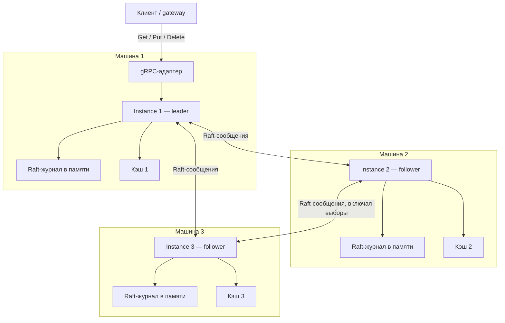
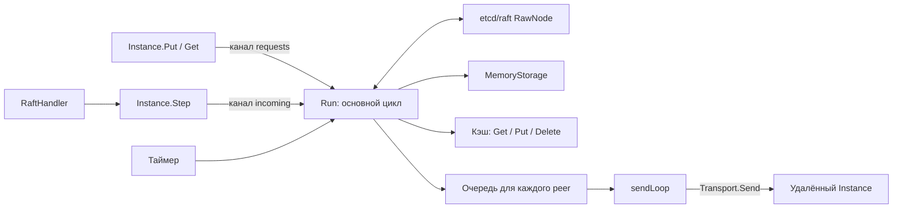
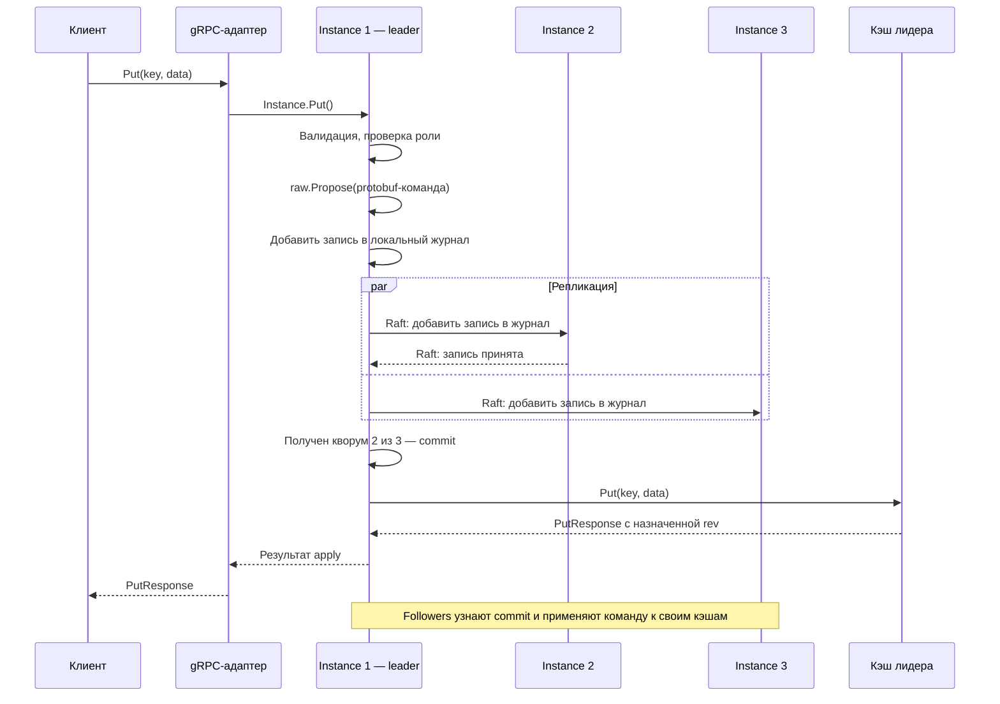
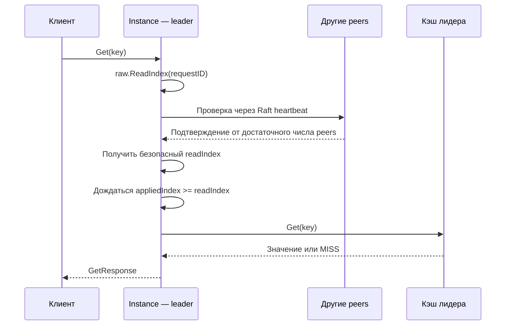
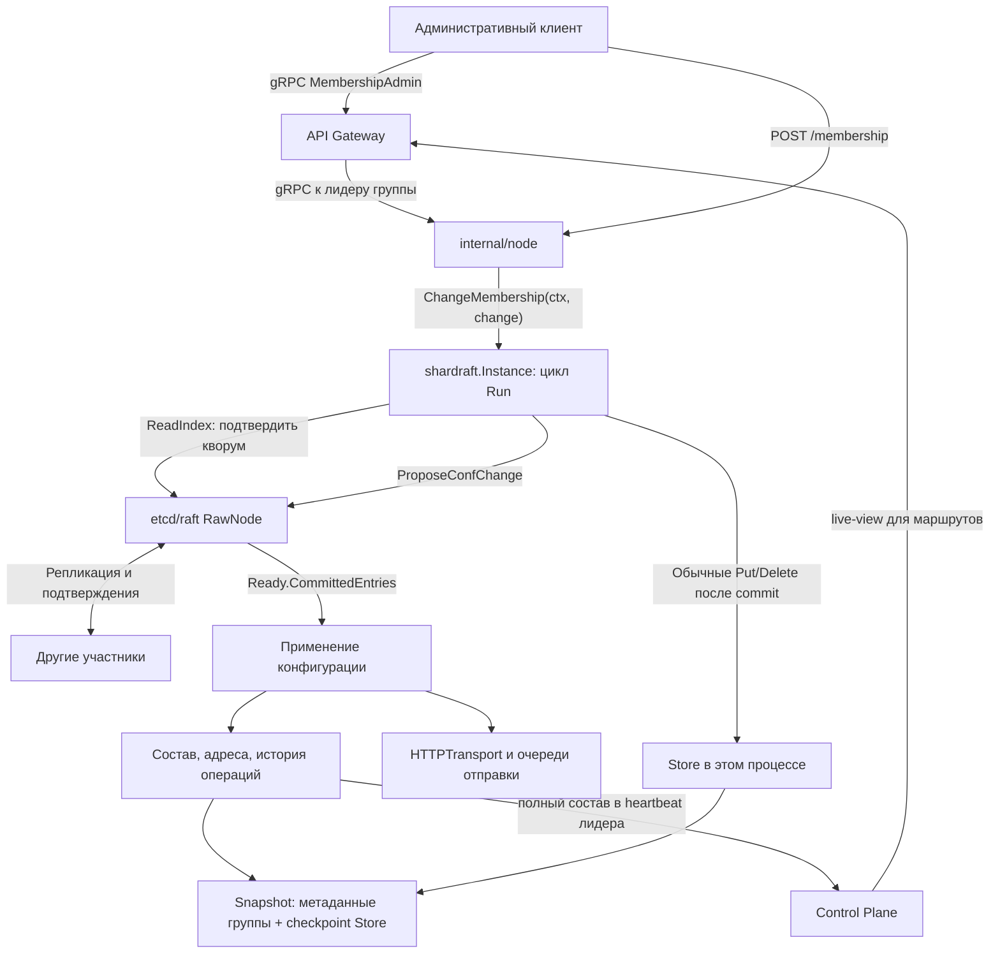
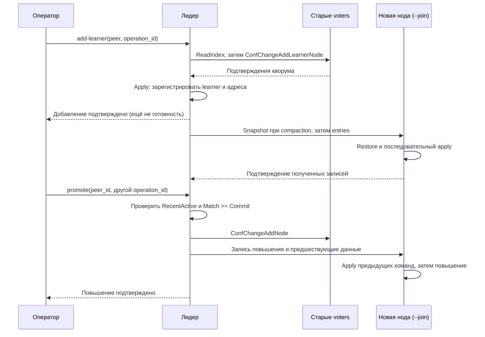

# Модуль shardraft: устройство и динамический состав Raft-группы

`shardraft` — обычный Go-пакет в приложении OraCache. Один `Instance` содержит
один кэш и состояние одного участника Raft. В рабочем развёртывании:
**одна машина = один инстанс = одна реплика одного шарда**. Три машины образуют
группу с кворумом 2 из 3. Все запускают одинаковый код; лидерство определяется
выборами и меняется без перезапуска. Флага `master=true` нет.

В тесте три независимых инстанса запускаются внутри одного процесса. Это
эмуляция трёх машин для проверки протокола, а не модель физической отказоустойчивости.

На схеме показана группа после выборов. Роль лидера может перейти любой машине;
gRPC-адаптер есть у каждого инстанса, но здесь показан только путь к лидеру.



## Навигация

- [API и запуск](#api-и-запуск), [bootstrap и join](#bootstrap-и-join).
- [Граница с приложением и CP](#граница-с-cli-и-control-plane).
- [Путь записи](#почему-один-цикл-и-что-происходит-при-put), [контракт кэша](#формат-команды-и-контракт-кэша), [чтения](#чтения-и-ошибки-маршрутизации).
- [Динамический состав группы](#динамический-состав-группы): learner, повышение, замена, удаление и повторы.
- [Snapshots](#snapshots-и-отсутствие-диска), [настройки и ограничения](#настройки-и-ограничения).
- [Ручной запуск](#ручная-демонстрация-без-docker-и-cp), [проверки корректности](#быстрая-демонстрация).

## Что готово

- Bootstrap группы, выборы и перевыборы на `go.etcd.io/raft/v3 v3.6.0`.
- Динамический membership: learner, повышение, удаление и замена через joint consensus.
- Все пять методов `gatewayv1.CacheGatewayClient`.
- Запись только через лидера, ответ после commit и локального apply.
- Строгие чтения через ReadIndex или явно выбранные локальные чтения.
- Подключаемый кэш с checkpoint/restore: versioned Store в `storage-node`
  и адаптер простого `internal/cache` для примеров и тестов.
- Snapshot, compaction и восстановление отставшего follower в памяти.
- Транспорт в памяти для тестов и HTTP transport для отдельных машин.
- gRPC-адаптер публичного API и статус для CP Agent.

Персистентности, межрегиональной репликации, TTL,
дедупликации пользовательских Put и защиты от устаревшего заполнения из БД пока нет.
CLI ноды, CP Agent, сам control plane и маршрутизирующий gateway находятся
за границей пакета. Существующий `cmd/gateway` продолжает запускать локальный
кэш; он автоматически не превращается в Raft-ноду.

## Быстрая демонстрация

Из корня репозитория:

```sh
go test -race -v ./shardraft -run '^TestClusterPutGetAndFailover$'
```

Тест создаёт три инстанса с отдельными кэшами, ждёт лидера, выполняет Put/Get,
проверяет данные непосредственно на followers, останавливает лидера, ждёт
перевыборов и продолжает работу. Затем теряет кворум и проверяет отказ записи.

`TestPartitionAndSnapshotCatchup` изолирует старого лидера, проверяет запрет
строгого чтения, пишет через новое большинство и возвращает старую ноду
через snapshot. `TestHTTPClusterAndGRPCAdapter` проверяет настоящие TCP/HTTP
соединения между peers и максимальную пачку 1000 × 10 КиБ через gRPC.
Docker для этих тестов не нужен.

Проверки модуля и его интеграции с нодой:

```sh
go test -race -count=1 ./shardraft ./internal/node
go test -race -count=1 -v ./internal/node -run '^TestHTTPMembershipReplacesLostStore$'
make test
make vet
```

Тесты покрывают догоняние по журналу и snapshot, запрет преждевременного повышения
и чтений с learner, запись при отключённом learner, замену при двух живых voters,
работу нового кворума после следующего отказа, повтор после отмены и смены лидера,
смену лидера прямо во время добавления, сохранение tombstones и запрет
обслуживания удалённой живой нодой.
HTTP-тест использует настоящий versioned Store и gRPC без Docker.

## API и запуск

Основные типы находятся в [config.go](../shardraft/config.go), lifecycle —
в [instance.go](../shardraft/instance.go), клиентский и серверный API — в [client.go](../shardraft/client.go).

```go
network := shardraft.NewMemoryNetwork()
peers := []shardraft.Peer{{ID: 1}, {ID: 2}, {ID: 3}}

node, err := shardraft.NewInstance(shardraft.Config{
    RegionID: "region-a",
    ShardID: 1,
    GroupID: "region-a/shard-1/demo-1",
    PeerID: 1,
    Peers: peers,
}, shardraft.AdaptCache(cache.New()), network)
if err != nil {
    return err
}
if err := network.Register(node); err != nil {
    return err
}

// Создать и зарегистрировать peers 2 и 3 таким же способом, каждый со своим cache.New().
// Run каждого инстанса вызвать в отдельной goroutine и собрать его результат.
runResult := make(chan error, 1)
go func() { runResult <- node.Run(ctx) }()

// После выборов вызвать Put/Get у инстанса-лидера.
// node.Status() показывает Role, LeaderID, Term и Ready.

// При завершении:
_ = node.Close()
if err := <-runResult; err != nil {
    return err
}
```

Полный исполняемый пример трёх участников —
[TestClusterPutGetAndFailover](../shardraft/instance_test.go). Пакет кэша в примере:
`github.com/OraCache/oracache/internal/cache`; он доступен приложению и тестам
внутри репозитория. Внешний пользователь передаёт собственную `StateMachine`.

`NewInstance` валидирует конфигурацию и создаёт состояние bootstrap или пустой
join-инстанс, но не запускает goroutines, listeners или heartbeat.
`Run(ctx)` — блокирующий цикл;
он возвращает nil при штатной отмене/Close и ошибку при фатальном сбое применения.
`Close()` идемпотентен, разрешён до Run и ждёт завершения цикла и send workers.
Повторный Run, в том числе после остановки, запрещён.

Состояние кэша при конструировании должно быть пустым. Нельзя дать всем peers
один объект кэша или загрузить произвольный checkpoint перед bootstrap.
Восстановлением существующего участника занимается только Raft snapshot path.

## Bootstrap и Join

* `Join=false`: создаёт новую группу через `RawNode.Bootstrap`. Начальные ноды
  получают одинаковые GroupID и список voters.
* `Join=true`, CLI `--join`: запускает пустой RawNode **без Bootstrap**.
  Peers содержит seed-адреса и описание самой новой ноды, но не назначает голоса.
  До добавления и повышения эта нода не обслуживает CacheGateway.

При замене используются **новые PeerID и NodeID**, но прежний GroupID.
Пустой процесс нельзя запускать под ID существующего участника: он потерял
term/vote. Использованные PeerID сохраняются в истории и не принимаются повторно.
Рекомендуется передавать адреса всех текущих участников как seeds, чтобы
недоступность одного seed не препятствовала первоначальному подключению.
Настройки Store (`max-bytes`, `max-versions`, размер значения) должны совпадать
у всех реплик. Restore проверяет конфигурацию checkpoint; при догонянии только
по журналу отдельного автоматического сравнения настроек пока нет.

## Граница с CLI и control plane

Приложение-хост отвечает за:

1. Чтение флагов/конфига, ID, адресов и выбор реализации кэша.
2. Создание transport и `Instance`.
3. Запуск HTTP-сервера Raft transport и membership API, gRPC-сервера клиентских операций.
4. Запуск Run и периодическую отправку `Status()` в CP.
5. Обработку фатальной ошибки Run и корректное завершение серверов и инстанса.

В `storage-node` эти обязанности выполняет `internal/node.Node`: он связывает
Store, `Instance`, сетевые серверы и необязательный CP Agent.
Библиотека не обращается к CP. Конструктор получает начальный состав или seeds;
дальнейшие изменения состава проходят через Raft. Исчезновение heartbeat
само по себе не меняет состав voters.
CP только наблюдает роль, выбранную Raft. Gateway использует его маршруты
как подсказки и обрабатывает NotLeader.

`Status()` безопасен из любой goroutine. Он содержит идентичность, роль, term,
leader ID, commit/applied/snapshot index, IsLearner, Member, Running, Ready и LastError.
Ready означает, что инстанс является voter, знает лидера и применил известный
ему committed-префикс. Learner и участник, применивший своё удаление, не ready.
Это **не доказательство живого кворума или отсутствия отставания**.
При сетевой изоляции наблюдаемый статус может устареть; строгий Get всё равно
проходит через ReadIndex. Поле LastError содержит фатальную ошибку Run, а не
все временные ошибки сети.

Для production-подобного запуска транспорт на каждой машине создаётся так:

```go
transport, err := shardraft.NewHTTPTransport(map[uint64]string{
    1: "http://node-1:7001/raft",
    2: "http://node-2:7001/raft",
    3: "http://node-3:7001/raft",
}, httpClient)
// Проверить err; передать transport в NewInstance.
// Смонтировать node.RaftHandler() на /raft своего http.Server.

server := grpc.NewServer(grpc.MaxRecvMsgSize(16 << 20))
gatewayv1.RegisterCacheGatewayServer(server, shardraft.GatewayServer(node))
```

Адреса HTTP transport отличаются от `Peer.Address`: последнее поле содержит
адрес клиентского gRPC и используется в подсказке NotLeader. `Peer.RaftAddress`
задаёт URL Raft transport, `Peer.NodeID` — идентичность ноды в приложении/CP.
При bootstrap список peers одинаков на трёх машинах; у join-ноды это seeds,
а не назначенный состав voters. Own PeerID различается; GroupID одинаков.
Пример полного сетевого подключения есть в [http_transport_test.go](../shardraft/http_transport_test.go).

HTTP transport выбран для простоты интеграции без нового публичного protobuf
сервиса; внутри передаются бинарные protobuf-сообщения etcd/raft. Можно заменить
его транспортом gRPC, реализовав один метод `Transport.Send` и доставку в Step.
Send обязан соблюдать context и возвращать nil после принятия сообщения
принимающим инстансом. Это транспортное подтверждение, а не commit.

Серверы, listeners и http.Client принадлежат хосту. Он задаёт сетевые таймауты
и закрывает idle connections после остановки ноды. Пакет не реализует
аутентификацию peers; GroupID проверяет маршрутизацию, но не является паролем.
Обычный HTTP предназначен для доверенного локального стенда; клиент/сервер
могут быть настроены хостом на HTTPS и проверку доступа.

## Почему один цикл и что происходит при Put

Используется `etcd/raft.RawNode`, доступ к которому должен быть последовательным.
Единственный цикл Run владеет RawNode, apply-позицией и кэшем. Так не нужно
синхронизировать apply, чтение и checkpoint несколькими независимыми mutex.
Сетевая отправка вынесена в отдельный worker на peer с очередью на 8 сообщений.
Недоступный peer не блокирует основной цикл.



Путь Put/Delete/BatchPut:

```text
protobuf request → валидация → проверка роли → proposal
→ журнал Raft → commit большинством → последовательный apply в кэш
→ protobuf response клиенту
```

Например, клиент записывает `profile:42 = hello`. На диаграмме ответ второго
follower задерживается: лидеру достаточно собственного журнала и подтверждения
одного follower для кворума 2 из 3.



Подтверждение на диаграмме — ответ протокола Raft о принятии записи в журнал.
HTTP-ответ о доставке сообщения сам по себе не означает commit. Применение
на followers может произойти как до, так и после ответа клиенту.

Все реплики применяют одинаковые committed-команды в одинаковом порядке.
Версии назначает кэш при apply. Raft index и версия ключа — разные счётчики.
Успех записи требует commit и apply на отвечающем лидере; followers могут
ещё не применить её. В этом PoC подтверждение хранится только в RAM.

В Ready-цикле обновляются MemoryStorage/HardState, отправляются сообщения,
применяются committed entries и вызывается Advance. Помимо пользовательских
команд, цикл применяет начальную конфигурацию и изменения состава ConfChangeV2.
Snapshot устанавливается
перед применением следующего хвоста журнала. Сериализация Raft messages также
происходит в основном цикле, до передачи байтов worker-ам.

## Формат команды и контракт кэша

Payload команды — существующий `PutRequest`, `DeleteRequest` или `BatchPutRequest`,
сериализованный protobuf. Небольшой бинарный заголовок содержит:

| Байты | Содержание |
| --- | --- |
| 0 | Версия формата: 1 |
| 1 | Операция: Put=2, Delete=3, BatchPut=5 |
| 2–9 | ID предлагающего peer, big endian uint64 |
| 10–17 | Последовательный ID вызова этого peer, big endian uint64 |
| 18 и далее | Исходный protobuf request |

Заголовок связывает apply с ожидающим вызовом. Он не является механизмом
дедупликации: повторный клиентский RPC получает новый ID. Неизвестная версия,
повреждённая команда и неожиданный сбой apply останавливают инстанс.
RoutingHints пока не влияют на работу одношардовой группы.

`StateMachine` требует Get/Put/Delete с клиентскими protobuf-сигнатурами и
Checkpoint/Restore. Batch реализован адаптером последовательным вызовом
одиночных методов. Ключи всей пачки валидируются до proposal. BatchPut — одна
команда журнала; доменные CONFLICT/TOO_LARGE отдельных элементов не откатывают
остальные. BatchGet использует один read barrier. Другой apply не вклинивается
между элементами пачки. При ошибке исчерпания счётчика возможен частичный
BatchPut, как у существующего кэша.

В `storage-node` используется [адаптер Store](../internal/node/statemachine.go).
Это versioned LRU-хранилище: rev берётся из глобального счётчика Store и не
обязана идти подряд для отдельного ключа. Get вызывает `Peek`, поэтому не меняет
LRU и не продлевает TTL: порядок вытеснения определяется только реплицируемыми
записями. Иначе локальные чтения приводили бы к разному состоянию реплик.
Настройки Store должны совпадать у всех участников.

`AdaptCache(cache.New())` в примере выше использует отдельный простой кэш
`internal/cache`; его не следует путать с ограниченным по памяти Store.

Требования к реализации `StateMachine`:

- одинаковый исходный state + одинаковые команды дают одинаковый результат;
- Get не изменяет TTL или другие данные;
- у каждой ноды свой кэш; внешние прямые изменения запрещены;
- методы завершаются за ограниченное время и не выполняют внешние RPC;
- успешная операция возвращает ненулевой response; данные не должны изменяться
  после возврата за счёт общей ссылки на внутренний буфер;
- checkpoint соответствует одному состоянию, restore полностью заменяет его;
- возвращаемые прикладные gRPC-ошибки должны быть детерминированными.

Нормальными ошибками применения считаются InvalidArgument, ResourceExhausted,
FailedPrecondition, OutOfRange, AlreadyExists и NotFound. Другие ошибки записи
останавливают Run: нельзя пропустить committed-команду на одной реплике.
Гонка устаревшего заполнения из БД остаётся за рамками; существующий expected_rev
сохраняется и проверяется внутри apply.

Клиентский context управляет ожиданием RPC. После commit команда применяется
с независимым context, даже если клиент уже ушёл. Checkpoint/Restore и apply
не должны самостоятельно прерываться по клиентскому deadline.

## Чтения и ошибки маршрутизации

По умолчанию `ReadMode = Linearizable`:

```text
Get на лидере → ReadIndex с подтверждением кворума
→ ожидание applied_index >= read_index → чтение кэша
```



Get не попадает в журнал. Проверки `role == leader` недостаточно: изолированный
старый лидер может ещё не знать, что большинство выбрало другого.

При `ReadMode = Local` Get/BatchGet читают локальный applied state любой ready-ноды.
После успешного Put такой Get может вернуть старые данные или MISS. Верхняя
граница отставания не обещается. Этот режим подходит для случайного выбора
реплики gateway только при явно принятой eventual-consistency семантике.

Запись follower и строгий Get follower возвращают `*NotLeaderError` до proposal.
В Go его можно разобрать через `errors.As`. Через gRPC это FailedPrecondition
с ErrorInfo: domain `oracache.shardraft`, reason `NOT_LEADER`, metadata
`leader_id`, `address`, `term`. Подсказка может быть пустой или устаревшей.
Встроенного forwarding и автоматического повторения записей нет.

После timeout, отмены или остановки исход записи может быть неизвестен.
Повторный Put способен создать новую версию. Автоматический повтор допускается
только после гарантированного отказа до proposal, например NotLeader; даже
такие перенаправления должны иметь общий deadline. Сетевые ошибки нельзя
превращать в MISS.

Instance реализует `CacheGatewayClient`, но непустые `grpc.CallOption` при
прямом вызове отвергает с InvalidArgument: сетевые настройки не имеют
in-process семантики. Для headers, receive limits и других опций используйте
обычный сгенерированный gRPC-клиент к `GatewayServer(node)`.

## Динамический состав группы

Membership позволяет добавить пустую ноду или заменить потерявшего память
участника без перезапуска остальных. Для изменения состава необходимо живое
большинство старой группы: потеря всего кворума не исправляется добавлением
пустых нод. Поддерживается как прямой административный HTTP API, так и отдельный
gRPC API через Gateway при подключённом Control Plane.

### Путь административного запроса



`Config.Peers` — исходные адреса. После запуска источником истины становятся
применённые записи Raft. Адреса в транспорте обновляются при apply или restore.
Административные команды не меняют интерфейс пользовательских Get/Put/Delete.
Для собственного транспорта нужен `MembershipTransport`: проверка описания
peer и безопасное обновление адреса параллельно с Send. Оба встроенных
транспорта реализуют этот интерфейс; статический Transport остаётся пригоден
для прежних групп, но отклоняет динамическое добавление.

CP не инициирует изменения состава. Лидер публикует полный применённый состав
после конфигурационного перехода, после избрания и в каждом обычном heartbeat.
CP хранит его отдельно от статического `ReplicaNodeIDs`, сравнивает по
`configIndex` и отдаёт Gateway вместе с актуальными состояниями нод. Learner
виден в составе, но не входит в клиентские маршруты. При отсутствии свежего
подтверждения лидера состав помечается неподтверждённым. Изменение `GroupID`
требует новой revision статической конфигурации с явной привязкой группы.

### Добавление и повышение learner



Learner получает данные, но не голосует и не обслуживает запросы даже в режиме
Local. Его `Ready=false`. Старые три voters продолжают работать с кворумом 2 из 3.

Перед повышением лидер проверяет, что реплика недавно отвечала и подтвердила
журнал до текущего commit index. **Match означает получение журнала, а не
завершение работы Store.** Нода применяет все команды перед записью повышения
и только затем получает право голоса и обслуживания. Это обеспечивается
последовательным apply в Run.

Успешный RPC подтверждает apply на лидере. Другие ноды могут применить ту же
запись чуть позже; их `Status()` и `Membership()` обновятся после локального apply.
Повышение четвёртой реплики создаёт четыре voters с кворумом 3. Для замены
умершей ноды используйте `replace`, а не отдельный `promote`.

### Замена и удаление участника

Пусть voters — A, B, C, а C потеряна. A и B сохраняют кворум 2 из 3:

1. Запустить D с новым ID и `--join`.
2. Добавить D как learner. Кворум остаётся прежним.
3. Дождаться догоняния; вызвать `replace(peer_id=D, remove_id=C)`.
4. Raft входит в совместную конфигурацию: старая ABC и новая ABD.
   Для commit нужны большинство ABC **и** большинство ABD.
5. Raft автоматически завершает переход. Ответ приходит после apply конечной
   конфигурации на лидере: A, B, D, кворум снова 2 из 3.

Промежуточной обычной группы ABCD с обязательным кворумом 3 нет. Во время
перехода A и B достаточны для обеих конфигураций. Ещё один отказ до завершения
перехода может лишить группу старого большинства; такую потерю кворума этот
протокол не устраняет.

`remove` также использует совместную конфигурацию. Живая нода, применившая своё
удаление, прекращает обслуживание, включая Local reads. Изолированная нода может
ещё не знать об удалении: остановите старый процесс и уберите его из маршрутов.
Local reads изначально допускают произвольно устаревшие данные.

### API membership и повторы

Для прямого Go-вызова есть отдельные методы `AddLearner(ctx, operationID, peer)`,
`PromoteLearner(ctx, operationID, peerID)`, `RemoveNode(ctx, operationID, peerID)`
и `Replace(ctx, operationID, oldPeerID, learnerID)`
на `shardraft.Instance` и `internal/node.Node`. Они используют тот же путь commit,
проверки и дедупликацию, что `ChangeMembership` и HTTP API.

`AddLearner` уже добавляет участника в конфигурацию Raft, но **без права голоса**.
Он не повышается автоматически после догоняния. `PromoteLearner` проверяет его
готовность в момент вызова и при отставании возвращает `FailedPrecondition`.

`Replace` объединяет повышение **уже добавленного learner** и удаление старого
voter в один переход joint consensus. Он не добавляет пустую ноду, не ждёт её
догоняния и не запускает фоновое повышение. Если learner отсутствует или отстаёт,
возвращается `FailedPrecondition`, состав не изменяется. Это один согласованный
переход, а не последовательные вызовы `PromoteLearner` и `RemoveNode`.

```go
// Нода 4 уже добавлена как learner и догнала журнал. Заменяем ею voter 3.
result, err := instance.Replace(ctx, "replace-node-3-with-4", 3, 4)
observed := instance.Membership()
```

| Action | Поля кроме operation_id | Эффект |
| --- | --- | --- |
| `add-learner` | `peer` | Добавить нового участника без голоса |
| `promote` | `peer_id` | Повысить догнавшего learner |
| `replace` | `peer_id`, `remove_id` | Повысить learner и удалить старого voter |
| `remove` | `peer_id` | Удалить voter или learner |

На Raft HTTP listener `storage-node`:

* `GET /membership` возвращает локальный состав: `index`, `leader_id`, `term`,
  `joint`, `members`, `removed_ids`. Это наблюдение, оно может отставать.
* `POST /membership` принимает `group_id`, `operation_id`, `action` и поля
  операции. Адресовать текущему лидеру; group_id должен совпадать с группой.

Клиентский путь использует `MembershipAdmin.ChangeMembership` и
`MembershipAdmin.GetMembership` из `proto/cache/membership.proto` на существующих
gRPC listeners Gateway и storage-ноды. Запрос указывает `group_id`, `region` и
`partition_id`. Gateway выбирает лидера из принятого CP состава и следует
подсказке `NotLeader`, только если адрес принадлежит этой группе.

Operation ID содержит 1–128 байт UTF-8. Повтор **того же ID с тем же содержимым**
не создаёт новую запись. В ответе — исходный `change_index` и текущий состав.
История реплицируется, включается в snapshot и переживает смену лидера.
Повтор ID с другим содержимым возвращает `AlreadyExists`.

Отмена context, timeout или потеря ответа **не отменяют предложенную операцию**.
Найдите лидера и повторите исходный запрос с тем же ID. Состав в ответе может
уже измениться, но `change_index` останется прежним. Это не дедупликация
пользовательского Put: его повтор по-прежнему может создать новую версию.

| HTTP | Причина | Действие |
| --- | --- | --- |
| 400 | Неверные JSON, group_id, ID или URL | Исправить запрос |
| 409 / FailedPrecondition | Не лидер, learner отстаёт или переход недопустим | Проверить сообщение и состав; при отставании повторить позже |
| 409 / AlreadyExists | ID операции использован иначе | Восстановить исходный запрос |
| 503 | Другой переход ещё выполняется / нода не готова | Проверить состояние, повторить позже |
| 504 или обрыв соединения | Неизвестный исход | Повторить тот же запрос с тем же ID |
| 429 | Лимит ожидающих запросов или истории операций | Проверить лимиты |

Одновременно допускается один learner и один переход. Удаление текущего лидера
и изменение адреса существующего участника в этот MVP не входят.

## Snapshots и отсутствие диска

Через каждые SnapshotEntries применённых записей (включая служебные) цикл
делает checkpoint кэша, добавляет Raft index/term/membership и сокращает журнал.
Snapshot также хранит адреса участников, удалённые ID и историю административных
операций. После compaction он обновляется при изменении membership, чтобы новая
нода получила snapshot, в составе которого она уже присутствует.
Если compaction ещё не было, пустая нода может получить весь журнал без snapshot.
Payload состоит из длины JSON-метаданных (uint32 big endian), самих метаданных
и непрозрачного checkpoint кэша. Данные Store не кодируются в base64 второй раз.
Копирование состояния синхронное; для небольшого PoC это проще, но большой
snapshot задерживает apply и обработку heartbeat. Асинхронный snapshot потребует
отдельного стабильного представления состояния.

Store сохраняет конфигурацию, глобальный счётчик rev, оставшиеся версии и порядок
LRU. Restore проверяет checkpoint и соответствие настроек, затем заменяет
состояние целиком. Простой `internal/cache` сохраняет все свои версии и счётчики,
в том числе удалённых ключей. В обоих случаях restore не должен приводить к
переиспользованию rev. Формат checkpoint принадлежит реализации кэша, а оболочка
составов и истории membership — модулю `shardraft`.

Обычные Put/Get не получили дополнительных сетевых вызовов из-за membership.
Learner добавляет поток репликации и, при необходимости, передачу snapshot.
Streaming и ограничение скорости передачи пока отсутствуют.

Отставший follower получает snapshot и последующие entries. Это работает
при восстановлении связи с сохранившим память инстансом. Snapshot в памяти
**не даёт восстановления после падения процесса**.

Нельзя обнулить инстанс и вернуть его с тем же peer ID в работающую группу:
потеря term/vote нарушает предпосылки безопасности Raft. Выключенный peer можно
заменить новым ID через learner и `replace`. Изолированный можно вернуть,
сохранив объект, пока он не удалён из состава. Полный запуск с нуля создаёт
новый пустой кластер с новым GroupID. Без живого кворума замена невозможна.

## Настройки и ограничения

| Настройка | По умолчанию | Значение |
| --- | --- | --- |
| Join | false | Bootstrap новой группы; true запускает пустого участника с seeds |
| TickInterval | 100 мс | Шаг логического времени |
| HeartbeatTicks | 1 | Интервал heartbeat Raft |
| ElectionTicks | 10 | База рандомизированного election timeout |
| RequestTimeout | 5 с | Верхняя граница ожидания RPC; более короткий context имеет приоритет |
| SendTimeout | 1 с | Одна попытка доставки сообщения |
| MaxPending | 256 | Максимум ожидающих proposal/read requests |
| MaxCommandBytes | 16 МиБ | Заголовок + сериализованный request |
| SnapshotEntries | 1000 | Интервал snapshot/compaction; 0 выбирает default |

Raft ограничивает uncommitted payload 64 МиБ; очереди отправки ограничены
числом сообщений, а не общим RSS. Входящее Raft-сообщение ограничено 64 МиБ,
payload snapshot вместе с метаданными — 63 МиБ. Это ограничения демонстрационного транспорта; большой
набор данных потребует streaming snapshots и пересмотра бюджетов памяти.
Для `storage-node` бюджет Store — **8 МиБ по умолчанию и максимум**. Ключи JSON
могут расширяться до 6 раз; нужен также запас под метаданные. Store отдельно от
этого приложения сохраняет default 256 МиБ. Raft-адаптер отвергает запись,
если одна пара ключ/значение с накладными расходами уже превышает бюджет Store.

При прямом использовании библиотеки произвольный `StateMachine` обязан укладывать
checkpoint вместе с метаданными в лимит snapshot. Простой `internal/cache`
хранит все версии без общего бюджета памяти. При превышении snapshot-лимита
Run завершится ошибкой, а не удалит данные. Эти ограничения не задают лимит RSS:
сериализация и передача создают дополнительные копии.

Клиентский gRPC сервер должен принимать 16 МиБ; для больших BatchGet клиенту
нужен `grpc.MaxCallRecvMsgSize(16 << 20)`. Сетевые серверы запускает хост.
Регион и shard ID используются в статусе; GroupID идентифицирует конкретную
группу на транспортной границе. Настройки состава и идентичности должны быть
согласованы до запуска; CP не исправляет несовместимый bootstrap автоматически.

* История ограничена 128 известными PeerID (включая удалённые) и 1024 операциями
  на жизнь группы. Старые ID не забываются молча. Длительная эксплуатация
  потребует политики хранения истории и персистентности.
* Адреса и NodeID активных участников уникальны. Для замены заранее выделите
  новый endpoint; переназначение занятого адреса не реализовано.
* `/membership` использует тот же listener, что `/raft`, и рассчитан на закрытую
  сеть. Аутентификации пока нет; это не публичный пользовательский API.
* Новый gRPC `MembershipAdmin` также пока без аутентификации; доступ к нему
  следует ограничивать сетью и правами запуска административного клиента.
* Смешивание старого и нового бинарника не поддерживается: формат snapshot
  изменился, старая версия не умеет применять ConfChangeV2.

## Ручная демонстрация без Docker и CP

Из корня репозитория, Bash, свободные порты 28091–28094 и 28191–28194.
Процессы запускаются в фоне; команды выполняются в одной сессии.

```bash
make build
peers=(
  --peer=1,node-1,127.0.0.1:28091,http://127.0.0.1:28191/raft
  --peer=2,node-2,127.0.0.1:28092,http://127.0.0.1:28192/raft
  --peer=3,node-3,127.0.0.1:28093,http://127.0.0.1:28193/raft
)
for id in 1 2 3; do
  ./bin/storage-node --node-id="node-$id" --peer-id="$id" \
    --group-id=membership-demo "${peers[@]}" --snapshot-entries=8 \
    --grpc-listen="127.0.0.1:$((28090+id))" \
    --raft-listen="127.0.0.1:$((28190+id))" \
    >"/tmp/oracache-membership-$id.log" 2>&1 &
  pids[$id]=$!
done
for port in 28191 28192 28193; do curl -sS "http://127.0.0.1:$port/status"; done
```

Подождите выборов. По `Role=StateLeader` выберите адреса лидера. Ниже пример
для ноды 1; при другом лидере замените оба адреса:

```bash
LEADER_HTTP=http://127.0.0.1:28191
export ORACACHE_ENDPOINT=127.0.0.1:28091
for value in 1 2 3 4 5 6 7 8 9 10 11 12; do
  ./bin/oracache put demo:key "$value"
done
./bin/storage-node --node-id=node-4 --peer-id=4 --join \
  --group-id=membership-demo "${peers[@]}" --snapshot-entries=8 \
  --peer=4,node-4,127.0.0.1:28094,http://127.0.0.1:28194/raft \
  --grpc-listen=127.0.0.1:28094 --raft-listen=127.0.0.1:28194 \
  >/tmp/oracache-membership-4.log 2>&1 &
pids[4]=$!

curl -sS "$LEADER_HTTP/membership" -H 'Content-Type: application/json' -d '{
  "group_id":"membership-demo", "operation_id":"add-4", "action":"add-learner",
  "peer":{"id":4,"node_id":"node-4","address":"127.0.0.1:28094",
          "raft_address":"http://127.0.0.1:28194/raft"}
}'
curl -sS http://127.0.0.1:28194/status
```

Нода 4 пока learner, `Ready=false`. Для замены, например, ноды 3 (если она не
лидер), остановите именно её процесс:

```bash
kill "${pids[3]}"
curl -sS "$LEADER_HTTP/membership" -H 'Content-Type: application/json' -d '{
  "group_id":"membership-demo", "operation_id":"replace-3-with-4",
  "action":"replace", "peer_id":4, "remove_id":3
}'
curl -sS "$LEADER_HTTP/membership"
./bin/oracache get demo:key
./bin/oracache put demo:key after-replacement
```

Если learner отстаёт, повторите **тот же** `replace`. Успех: `joint=false`, voters
1, 2, 4. Для добавления четвёртого voter вместо замены не останавливайте ноду 3
и используйте `promote`, `peer_id=4` без remove_id, с новым operation_id.

После демонстрации остановите созданные процессы: `kill "${pids[@]}"`.
Следующий полный запуск создаст пустой кластер; выберите для него новый GroupID.

## Где расширять дальше

| Возможность | Место изменения |
| --- | --- |
| Персистентность | Storage, порядок Ready и путь восстановления при запуске |
| TTL | Детерминированные команды и StateMachine, не независимые таймеры peers |
| Дедупликация | Стабильный клиентский request ID, состояние результатов и checkpoint |
| Межрегиональный outbox | Общая атомарная граница cache+outbox при apply, отдельный sender |
| Управление составом из CP | Вызовы Membership API и сверка принятого состава с размещением |
| Другой сетевой протокол | Transport.Send и адаптер доставки в Step |

Выбрана библиотека etcd/raft, потому что она реализует протокол, оставляя
приложению явные границы транспорта, хранения и применения команд.
Источники: [etcd/raft v3.6.0](https://github.com/etcd-io/raft/tree/v3.6.0),
[контракт Ready/Storage](https://github.com/etcd-io/raft/blob/v3.6.0/doc.go),
[RawNode](https://github.com/etcd-io/raft/blob/v3.6.0/rawnode.go).
