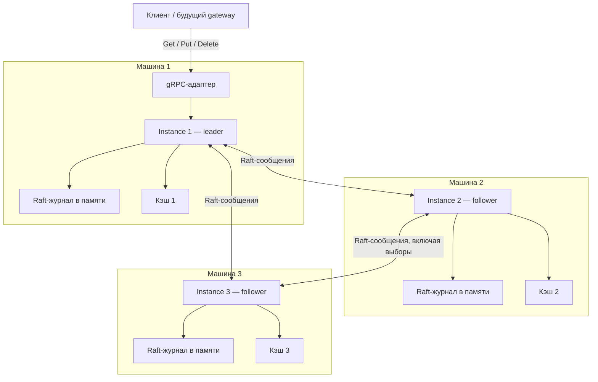
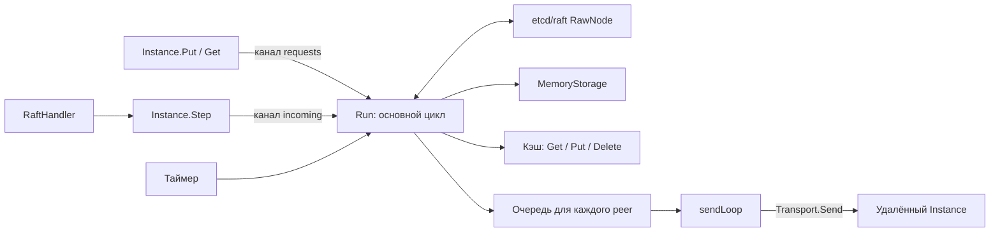
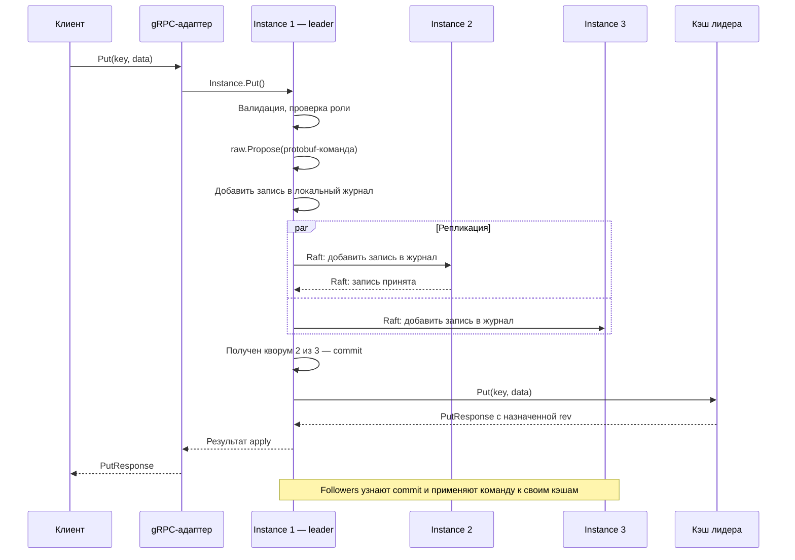
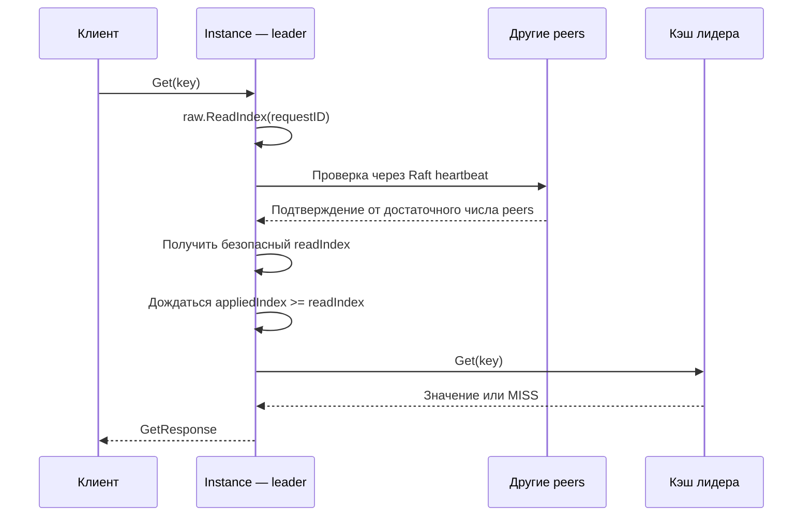

# shardraft: одна реплика Raft-группы

`shardraft` — обычный Go-пакет в приложении OraCache. Один `Instance` содержит
один кэш и состояние одного участника Raft. В рабочем развёртывании:
**одна машина = один инстанс = одна реплика одного шарда**. Три машины образуют
группу с кворумом 2 из 3. Все запускают одинаковый код; лидерство определяется
выборами и меняется без перезапуска. Флага `master=true` нет.

В тесте три независимых инстанса запускаются внутри одного процесса. Это
эмуляция трёх машин для проверки протокола, а не модель физической отказоустойчивости.

На схеме показана группа после выборов. Роль лидера может перейти любой машине;
gRPC-адаптер есть у каждого инстанса, но здесь показан только путь к лидеру.



## Что готово

- Статический список voters, выборы и перевыборы на `go.etcd.io/raft/v3 v3.6.0`.
- Все пять методов `gatewayv1.CacheGatewayClient`.
- Запись только через лидера, ответ после commit и локального apply.
- Строгие чтения через ReadIndex или явно выбранные локальные чтения.
- Подключаемый кэш с checkpoint/restore; адаптер существующего `internal/cache`.
- Snapshot, compaction и восстановление отставшего follower в памяти.
- Транспорт в памяти для тестов и HTTP transport для отдельных машин.
- gRPC-адаптер публичного API и статус для CP Agent.

Персистентности, изменения membership, межрегиональной репликации, TTL,
дедупликации запросов и защиты от устаревшего заполнения из БД пока нет.
CLI ноды, CP Agent, сам control plane и маршрутизирующий gateway находятся
за границей пакета. Существующий `cmd/gateway` продолжает запускать локальный
кэш; он автоматически не превращается в Raft-ноду.

## Быстрая демонстрация

Из корня репозитория:

```sh
go test -race -v ./shardraft -run '^TestClusterPutGetAndFailover$'
```

Тест создаёт три инстанса с отдельными кэшами, ждёт лидера, выполняет Put/Get,
проверяет данные непосредственно на followers, останавливает лидера, ждёт
перевыборов и продолжает работу. Затем теряет кворум и проверяет отказ записи.

Все проверки пакета:

```sh
go test -race ./shardraft
make test
make vet
```

`TestPartitionAndSnapshotCatchup` изолирует старого лидера, проверяет запрет
строгого чтения, пишет через новое большинство и возвращает старую ноду
через snapshot. `TestHTTPClusterAndGRPCAdapter` проверяет настоящие TCP/HTTP
соединения между peers и максимальную пачку 1000 × 10 КиБ через gRPC.
Docker для этих тестов не нужен.

## API и запуск

Основные типы находятся в [config.go](config.go), lifecycle —
в [instance.go](instance.go), клиентский и серверный API — в [client.go](client.go).

```go
network := shardraft.NewMemoryNetwork()
peers := []shardraft.Peer{{ID: 1}, {ID: 2}, {ID: 3}}

node, err := shardraft.NewInstance(shardraft.Config{
    RegionID: "region-a",
    ShardID: 1,
    GroupID: "region-a/shard-1/demo-1",
    PeerID: 1,
    Peers: peers,
}, shardraft.AdaptCache(cache.New()), network)
if err != nil {
    return err
}
if err := network.Register(node); err != nil {
    return err
}

// Создать и зарегистрировать peers 2 и 3 таким же способом, каждый со своим cache.New().
// Run каждого инстанса вызвать в отдельной goroutine и собрать его результат.
runResult := make(chan error, 1)
go func() { runResult <- node.Run(ctx) }()

// После выборов вызвать Put/Get у инстанса-лидера.
// node.Status() показывает Role, LeaderID, Term и Ready.

// При завершении:
_ = node.Close()
if err := <-runResult; err != nil {
    return err
}
```

Полный исполняемый пример трёх участников —
[TestClusterPutGetAndFailover](instance_test.go). Пакет кэша в примере:
`github.com/OraCache/oracache/internal/cache`; он доступен приложению и тестам
внутри репозитория. Внешний пользователь передаёт собственную `StateMachine`.

`NewInstance` валидирует конфигурацию и создаёт состояние bootstrap, но не
запускает goroutines, listeners или heartbeat. `Run(ctx)` — блокирующий цикл;
он возвращает nil при штатной отмене/Close и ошибку при фатальном сбое применения.
`Close()` идемпотентен, разрешён до Run и ждёт завершения цикла и send workers.
Повторный Run, в том числе после остановки, запрещён.

Состояние кэша при конструировании должно быть пустым. Нельзя дать всем peers
один объект кэша или загрузить произвольный checkpoint перед bootstrap.
Восстановлением существующего участника занимается только Raft snapshot path.

## Граница с CLI и control plane

Приложение-хост отвечает за:

1. Чтение флагов/конфига, ID, адресов и выбор реализации кэша.
2. Создание transport и `Instance`.
3. Запуск HTTP-сервера Raft transport и gRPC-сервера клиентских операций.
4. Запуск Run и периодическую отправку `Status()` в CP.
5. Обработку фатальной ошибки Run и корректное завершение серверов и инстанса.

Библиотека не обращается к CP. Статическая топология полностью передаётся
конструктору; исчезновение heartbeat не меняет состав voters.
CP только наблюдает роль, выбранную Raft. Gateway использует его маршруты
как подсказки и обрабатывает NotLeader.

`Status()` безопасен из любой goroutine. Он содержит идентичность, роль, term,
leader ID, commit/applied/snapshot index, Running, Ready и LastError.
Ready означает, что инстанс знает лидера и применил известный ему committed
префикс. Это **не доказательство живого кворума или отсутствия отставания**.
При сетевой изоляции наблюдаемый статус может устареть; строгий Get всё равно
проходит через ReadIndex. Поле LastError содержит фатальную ошибку Run, а не
все временные ошибки сети.

Для production-подобного запуска транспорт на каждой машине создаётся так:

```go
transport, err := shardraft.NewHTTPTransport(map[uint64]string{
    1: "http://node-1:7001/raft",
    2: "http://node-2:7001/raft",
    3: "http://node-3:7001/raft",
}, httpClient)
// Проверить err; передать transport в NewInstance.
// Смонтировать node.RaftHandler() на /raft своего http.Server.

server := grpc.NewServer(grpc.MaxRecvMsgSize(16 << 20))
gatewayv1.RegisterCacheGatewayServer(server, shardraft.GatewayServer(node))
```

Адреса HTTP transport отличаются от `Peer.Address`: последнее поле содержит
адрес клиентского gRPC и используется в подсказке NotLeader. Весь список peers
одинаков на трёх машинах. Own PeerID различается; GroupID одинаков.
Пример полного сетевого подключения есть в [http_transport_test.go](http_transport_test.go).

HTTP transport выбран для простоты интеграции без нового публичного protobuf
сервиса; внутри передаются бинарные protobuf-сообщения etcd/raft. Можно заменить
его транспортом gRPC, реализовав один метод `Transport.Send` и доставку в Step.
Send обязан соблюдать context и возвращать nil после принятия сообщения
принимающим инстансом. Это транспортное подтверждение, а не commit.

Серверы, listeners и http.Client принадлежат хосту. Он задаёт сетевые таймауты
и закрывает idle connections после остановки ноды. Пакет не реализует
аутентификацию peers; GroupID проверяет маршрутизацию, но не является паролем.
Обычный HTTP предназначен для доверенного локального стенда; клиент/сервер
могут быть настроены хостом на HTTPS и проверку доступа.

## Почему один цикл и что происходит при Put

Используется `etcd/raft.RawNode`, доступ к которому должен быть последовательным.
Единственный цикл Run владеет RawNode, apply-позицией и кэшем. Так не нужно
синхронизировать apply, чтение и checkpoint несколькими независимыми mutex.
Сетевая отправка вынесена в отдельный worker на peer с очередью на 8 сообщений.
Недоступный peer не блокирует основной цикл.



Путь Put/Delete/BatchPut:

```text
protobuf request → валидация → проверка роли → proposal
→ журнал Raft → commit большинством → последовательный apply в кэш
→ protobuf response клиенту
```

Например, клиент записывает `profile:42 = hello`. На диаграмме ответ второго
follower задерживается: лидеру достаточно собственного журнала и подтверждения
одного follower для кворума 2 из 3.



Подтверждение на диаграмме — ответ протокола Raft о принятии записи в журнал.
HTTP-ответ о доставке сообщения сам по себе не означает commit. Применение
на followers может произойти как до, так и после ответа клиенту.

Все реплики применяют одинаковые committed-команды в одинаковом порядке.
Версии назначает кэш при apply. Raft index и версия ключа — разные счётчики.
Успех записи требует commit и apply на отвечающем лидере; followers могут
ещё не применить её. В этом PoC подтверждение хранится только в RAM.

В Ready-цикле обновляются MemoryStorage/HardState, отправляются сообщения,
применяются committed entries и вызывается Advance. Начальные configuration
entries обрабатываются даже при статической топологии. Snapshot устанавливается
перед применением следующего хвоста журнала. Сериализация Raft messages также
происходит в основном цикле, до передачи байтов worker-ам.

## Формат команды и контракт кэша

Payload команды — существующий `PutRequest`, `DeleteRequest` или `BatchPutRequest`,
сериализованный protobuf. Небольшой бинарный заголовок содержит:

| Байты | Содержание |
| --- | --- |
| 0 | Версия формата: 1 |
| 1 | Операция: Put=2, Delete=3, BatchPut=5 |
| 2–9 | ID предлагающего peer, big endian uint64 |
| 10–17 | Последовательный ID вызова этого peer, big endian uint64 |
| 18 и далее | Исходный protobuf request |

Заголовок связывает apply с ожидающим вызовом. Он не является механизмом
дедупликации: повторный клиентский RPC получает новый ID. Неизвестная версия,
повреждённая команда и неожиданный сбой apply останавливают инстанс.
RoutingHints пока не влияют на работу одношардовой группы.

`StateMachine` требует Get/Put/Delete с клиентскими protobuf-сигнатурами и
Checkpoint/Restore. Batch реализован адаптером последовательным вызовом
одиночных методов. Ключи всей пачки валидируются до proposal. BatchPut — одна
команда журнала; доменные CONFLICT/TOO_LARGE отдельных элементов не откатывают
остальные. BatchGet использует один read barrier. Другой apply не вклинивается
между элементами пачки. При ошибке исчерпания счётчика возможен частичный
BatchPut, как у существующего кэша.

Требования к реализации Димы:

- одинаковый исходный state + одинаковые команды дают одинаковый результат;
- Get не изменяет TTL или другие данные;
- у каждой ноды свой кэш; внешние прямые изменения запрещены;
- методы завершаются за ограниченное время и не выполняют внешние RPC;
- успешная операция возвращает ненулевой response; данные не должны изменяться
  после возврата за счёт общей ссылки на внутренний буфер;
- checkpoint соответствует одному состоянию, restore полностью заменяет его;
- возвращаемые прикладные gRPC-ошибки должны быть детерминированными.

Нормальными ошибками применения считаются InvalidArgument, ResourceExhausted,
FailedPrecondition, OutOfRange, AlreadyExists и NotFound. Другие ошибки записи
останавливают Run: нельзя пропустить committed-команду на одной реплике.
Гонка устаревшего заполнения из БД остаётся за рамками; существующий expected_rev
сохраняется и проверяется внутри apply.

Клиентский context управляет ожиданием RPC. После commit команда применяется
с независимым context, даже если клиент уже ушёл. Checkpoint/Restore и apply
не должны самостоятельно прерываться по клиентскому deadline.

## Чтения и ошибки маршрутизации

По умолчанию `ReadMode = Linearizable`:

```text
Get на лидере → ReadIndex с подтверждением кворума
→ ожидание applied_index >= read_index → чтение кэша
```



Get не попадает в журнал. Проверки `role == leader` недостаточно: изолированный
старый лидер может ещё не знать, что большинство выбрало другого.

При `ReadMode = Local` Get/BatchGet читают локальный applied state любой ready-ноды.
После успешного Put такой Get может вернуть старые данные или MISS. Верхняя
граница отставания не обещается. Этот режим подходит для случайного выбора
реплики gateway только при явно принятой eventual-consistency семантике.

Запись follower и строгий Get follower возвращают `*NotLeaderError` до proposal.
В Go его можно разобрать через `errors.As`. Через gRPC это FailedPrecondition
с ErrorInfo: domain `oracache.shardraft`, reason `NOT_LEADER`, metadata
`leader_id`, `address`, `term`. Подсказка может быть пустой или устаревшей.
Встроенного forwarding и автоматического повторения записей нет.

После timeout, отмены или остановки исход записи может быть неизвестен.
Повторный Put способен создать новую версию. Автоматический повтор допускается
только после гарантированного отказа до proposal, например NotLeader; даже
такие перенаправления должны иметь общий deadline. Сетевые ошибки нельзя
превращать в MISS.

Instance реализует `CacheGatewayClient`, но непустые `grpc.CallOption` при
прямом вызове отвергает с InvalidArgument: сетевые настройки не имеют
in-process семантики. Для headers, receive limits и других опций используйте
обычный сгенерированный gRPC-клиент к `GatewayServer(node)`.

## Snapshots и отсутствие диска

Через каждые SnapshotEntries применённых записей (включая служебные) цикл
делает checkpoint кэша, добавляет Raft index/term/membership и сокращает журнал.
Копирование состояния синхронное; для небольшого PoC это проще, но большой
snapshot задерживает apply и обработку heartbeat. Асинхронный snapshot потребует
отдельного стабильного представления состояния.

Встроенный кэш сохраняет все версии и счётчики, в том числе удалённых ключей.
Это предотвращает переиспользование rev после restore. Формат его checkpoint —
версионированный JSON с бинарными значениями в base64. Restore сначала валидирует
новое состояние, затем заменяет старое целиком.

Отставший follower получает snapshot и последующие entries. Это работает
при восстановлении связи с сохранившим память инстансом. Snapshot в памяти
**не даёт восстановления после падения процесса**.

Нельзя обнулить инстанс и вернуть его с тем же peer ID в работающую группу:
потеря term/vote нарушает предпосылки безопасности Raft. В PoC выключенный peer
остаётся выключенным; изолированный можно вернуть, сохранив объект. Полный
запуск с нуля создаёт новый пустой кластер с новым GroupID. Восстановление
после падения потребует durable storage либо протокола замены участника.

## Настройки и ограничения

| Настройка | По умолчанию | Значение |
| --- | --- | --- |
| TickInterval | 100 мс | Шаг логического времени |
| HeartbeatTicks | 1 | Интервал heartbeat Raft |
| ElectionTicks | 10 | База рандомизированного election timeout |
| RequestTimeout | 5 с | Верхняя граница ожидания RPC; более короткий context имеет приоритет |
| SendTimeout | 1 с | Одна попытка доставки сообщения |
| MaxPending | 256 | Максимум ожидающих proposal/read requests |
| MaxCommandBytes | 16 МиБ | Заголовок + сериализованный request |
| SnapshotEntries | 1000 | Интервал snapshot/compaction; 0 выбирает default |

Raft ограничивает uncommitted payload 64 МиБ; очереди отправки ограничены
числом сообщений, а не общим RSS. Входящее Raft-сообщение ограничено 64 МиБ,
checkpoint — 63 МиБ. Это ограничения демонстрационного транспорта; большой
набор данных потребует streaming snapshots и пересмотра бюджетов памяти.
Существующий кэш хранит все версии, поэтому суммарный объём живого состояния
не ограничен этими настройками. При превышении checkpoint-лимита Run завершится
ошибкой, а не удалит данные.

Клиентский gRPC сервер должен принимать 16 МиБ; для больших BatchGet клиенту
нужен `grpc.MaxCallRecvMsgSize(16 << 20)`. Сетевые серверы запускает хост.
Регион и shard ID используются в статусе; GroupID идентифицирует конкретную
группу на транспортной границе. Настройки состава и идентичности должны быть
согласованы до запуска; CP не исправляет несовместимый bootstrap автоматически.

## Где расширять дальше

| Возможность | Место изменения |
| --- | --- |
| Персистентность | Storage, порядок Ready и путь восстановления при запуске |
| TTL | Детерминированные команды и StateMachine, не независимые таймеры peers |
| Дедупликация | Стабильный клиентский request ID, состояние результатов и checkpoint |
| Межрегиональный outbox | Общая атомарная граница cache+outbox при apply, отдельный sender |
| Изменение состава | Membership API, catchup и согласование с CP |
| Другой сетевой протокол | Transport.Send и адаптер доставки в Step |

Выбрана библиотека etcd/raft, потому что она реализует протокол, оставляя
приложению явные границы транспорта, хранения и применения команд.
Источники: [etcd/raft v3.6.0](https://github.com/etcd-io/raft/tree/v3.6.0),
[контракт Ready/Storage](https://github.com/etcd-io/raft/blob/v3.6.0/doc.go),
[RawNode](https://github.com/etcd-io/raft/blob/v3.6.0/rawnode.go).
